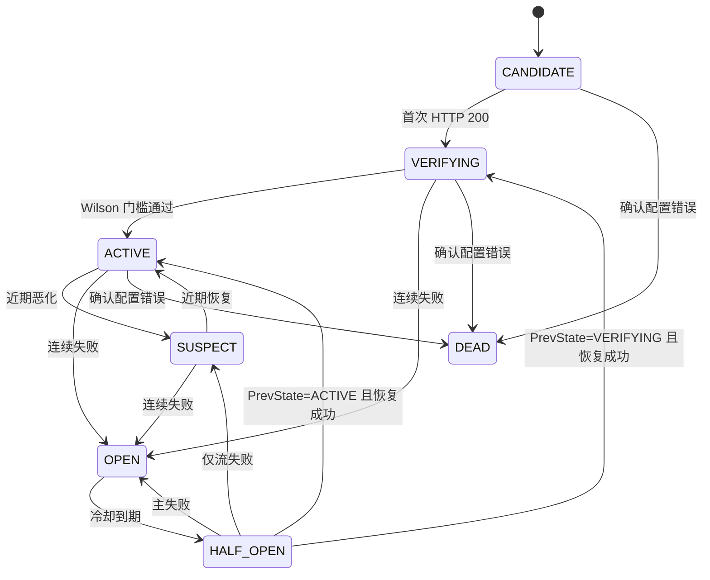

# 出口节点健康筛选与预算调度规格

| 字段 | 值 |
| :--- | :--- |
| 文档版本 | `v1.2.0` |
| 上一版本 | `v1.1.0` |
| 变更摘要 | 合并三轮自审查最终修订：`shadow` 默认、双蓄水池与 alpha-spending、观测生命周期、环境暂存、预算原子预占、持久化与验收补齐 |
| 状态 | Draft（待批准） |
| 日期 | 2026-10-22 |
| 适用代码 | `internal/egress/**`、`internal/gateway/**`、`internal/admin/**`、`webui/**` |
| 设计输入 | `E:\Files\Desktop\设计代理筛选算法.md` |
| 关联规格 | `project-context/specs/model-ranking.md` |

## 0. 摘要

Mesh 的出口池由大量低质量免费代理组成，现有路由已经具备节点准入、验证优先、冷却和快速发现，但证据只有节点级与目标主机级，无法回答“这个出口对这个模型、这个协议、这种请求模式是否稳定返回有效推理”。本规格把设计输入落成可执行方案：以 `出口 × 上游 × 模型 × 协议 × 请求模式` 为健康键，分别统计网络可达、HTTP 200、有效推理和延迟；用 Wilson 下界做准入判定，用时间衰减 Beta 后验做近期健康判断；以七态状态机管理熔断与恢复；真实流量优先积累证据，预算感知的金丝雀只在证据不足或需要恢复时补测；稳定池索引把请求路径从全池扫描改为增量索引抽样；Mesh 到节点端点的链路通过显式 bootstrap 与统一 transport 隔离，系统代理不得污染证据。方案分五个阶段上线，任一阶段可通过 `egress.health.mode` 回退。

## 1. 目标与现状差距

### 1.1 目标

1. 找出“能持续返回有效推理”的出口，降低 503 与无效重试。
2. 让准入判定有统计依据：达到样本量与置信下界才进入稳定池。
3. 用真实请求承担主要证据成本，金丝雀只在必要时补测。
4. 在 10 万级节点池下保持请求路径的低延迟选路。
5. 全部行为可观测、可配置、可回滚，且不改变现有尝试预算与归因纪律。

### 1.2 现状能力

| 能力 | 现有实现 | 位置 |
| :--- | :--- | :--- |
| 节点健康 | `failures`、`cooldown_until`、`ever_healthy`、`last_success_at` | `internal/egress/node/node.go` |
| 目标级归因 | 按 target host 记录 upstream 成功/失败 | `node.UpstreamStats`、`routing.UpstreamTracker` |
| 延迟 | 按 target host 的 TD-EWMA | `internal/egress/node/latency.go` |
| 主动探测 | 13–17s 扫描、双优先级队列、固定 worker、失败指数退避 | `internal/egress/probe/probe.go` |
| 快速发现 | TCP 预检 512 并发 + 主目标 HTTP 探测 128 并发 | `probe.ProbeBatchFast` |
| 路由 | 全池遍历、验证优先 10 分钟、加权随机、rendezvous 亲和 | `internal/egress/routing/router.go` |
| 归因与地区 | 上游共识、地区 403 隔离 30 分钟 | `routing/router.go`、`gateway/egress.go` |

### 1.3 差距

| 编号 | 差距 | 影响 |
| :--- | :--- | :--- |
| G1 | 证据只到节点与目标，未区分模型、协议、请求模式 | 同一节点在 Chat 成功、在 Messages 或流式请求失败时仍被判健康 |
| G2 | 任意 HTTP 响应都可能置 `ever_healthy`，快速 GET 探测无法证明推理可用 | 大量“可达但不可推理”的节点进入路由 |
| G3 | 没有样本量与置信下界，单次成功即可参与路由 | 冷启动与偶然成功污染稳定池 |
| G4 | 没有健康状态机，只有“冷却/不冷却” | 无法表达验证中、可疑、半开、长期淘汰 |
| G5 | 没有真正的推理金丝雀 | 新节点只能等真实流量，或在没有证据时被盲目使用 |
| G6 | 请求路径每次遍历全池 | 87k 节点下选路成本高，且分数计算放大了开销 |
| G7 | 探测没有全局预算与单键单飞 | 大规模补测可能触发上游限流或探测风暴 |
| G8 | 出站 transport 可能隐式读取系统代理或复用 `http.DefaultTransport` | 断网、切代理会污染证据并打冷全池，无法区分本地环境与节点故障 |

## 2. 边界与非目标

### 2.1 必须保持的约束

1. 上游地址唯一来源仍是 `upstream.zen/go/anonymous`，不新增 `target_domain`。
2. 唯一尝试总预算仍是 `retry.max_attempts`；本规格只改变“选哪个出口”，不改变尝试次数。
3. 节点层冷却与通道层冷却继续独立：`egress.cooldown` 处理出口故障，`performance.failure_cooldown_seconds` 处理 Key 通道。
4. 400/422 请求级拒绝立即原样返回，不计入出口健康样本。
5. 401/403 默认走通道层；403 响应体明确为地区限制时继续走地区隔离，不冷却节点。硬性地区封锁优先于可用性：全部候选被封锁时返回 `ErrNoEligible`。本规格取代 `AGENTS.md` 中“全部地区被隔离时回退”的旧表述，S1 必须同步更新该文件。探索配额（2% candidate + 8% verifying）同样修订“全池未验证时才回退”，S1 一并更新。
6. 业务配置在 `config.json`，健康状态在 `egress.state_path` 的 SQLite，二者分离。
7. 保持单二进制、单 SQLite、无外部队列；v1 不做分布式分片。
8. 不生成假数据，不为演示填充节点或指标。
9. Mesh 主机到节点端点的可达性是部署前提。所有 Mesh → 节点端点连接必须经过显式 bootstrap 策略；禁止 `ProxyFromEnvironment`、`http.DefaultTransport` 隐式复用或读取系统代理。客户端系统代理不属于健康键。

### 2.2 非目标

- 不实现按请求内容做语义级质量评估（例如回答正确率）。
- 不实现多机共享健康状态。
- 不在默认配置下用付费 Key 做金丝雀。
- 不替换现有快速批量刷新；它继续负责“可达性筛选”。
- 不读取系统代理，不实现 `auto` bootstrap；v1 `http_connect` 不支持 SOCKS5 节点。
- 不新增独立的管理页面；扩展现有节点页与总览页。

## 3. 健康键与证据模型

### 3.1 健康键

统计对象是五元组：

```go
// HealthKey 是健康统计的最小单位。NodeID 由所属 Entry 隐含。
type HealthKey struct {
	Target   string // 规范化上游：scheme://host[:port] + base path
	Model    string // 规范模型 ID；业务键不使用 "*"
	Protocol string // chat | responses | anthropic | systemone
	Mode     string // stream | json
}

// ReachabilityKey 是独立的可达性记录，不是普通 HealthKey。
type ReachabilityKey struct {
	Target string
}
```

规范化规则：

- `scheme` 小写；`host` 小写并去尾点；默认端口省略；IPv6 使用标准方括号；`base path` 去尾斜杠并保留大小写。
- `Target` 必须包含 base path。`https://opencode.ai/zen`、`https://opencode.ai/zen/go`、`https://opencode.ai/inference` 是三个不同的键。
- `userinfo`、query、fragment 不进入健康键、索引、日志或 API；防止凭据泄漏与同一端点被拆键。
- 探测配置、真实请求与路由共用 `NormalizeTarget`；`probe.Config.Targets` 必须保留 base path，不能降为 `scheme://host`。
- `Model` 使用模型目录中的规范 ID。`Model="*"`、`Protocol="*"`、`Mode="*"` 只允许出现在独立的 `ReachabilityKey` 记录中，永远不能进入 `active`/`verifying` 准入桶。
- 业务请求选中通配可达候选后，立即建立或读取精确 `Target × Model × Protocol × Mode` 键，所有业务证据只写该精确键。
- `Mode` 由请求体 `stream` 字段决定；无法判定时按请求协议默认值处理，不能长期使用通配值。

### 3.2 四类证据

| 证据 | 判定 | 用途 | 是否持久化 |
| :--- | :--- | :--- | :--- |
| 网络可达 | TCP 连接成功，或收到任意 HTTP 响应 | 候选筛选、快速刷新 | 是（`last_reachable`） |
| HTTP 200 | 状态码严格等于 200 | 可靠性主指标 | 是（计数） |
| 有效推理 | 200 且响应符合协议，且首事件/首段 JSON 不含错误载荷 | 稳定池准入（`valid_required=true`） | 是（计数） |
| 延迟 | 连接耗时、首字节耗时（TTFB）、总耗时 | 选路评分、可疑判定 | 是（EWMA + 直方图） |

`201`、`204` 等其他 2xx 不计入 HTTP 200 成功率。它们按“HTTP 200 失败、有效推理失败”处理。

### 3.3 结果分类矩阵

| 结果 | 证据归类 | 键级 HTTP 200 | 键级有效推理 | 状态影响 | 冷却层 |
| :--- | :--- | :--- | :--- | :--- | :--- |
| 200 + 有效载荷 | 推理成功 | 成功 | 成功 | 键级成功 | 无 |
| 200 + 错误/空载荷 | HTTP 成功、推理失败 | 成功 | 失败 | 键级失败 | 无 |
| 201/204 | 非目标状态 | 失败 | 失败 | 键级失败；客户端收到原响应，不重试 | 无 |
| 400/422 | 请求级拒绝 | 不计 | 不计 | 无 | 无 |
| 401 | 鉴权失败 | 不计 | 不计 | 无 | 通道层 |
| 403 普通 | 权限失败 | 不计 | 不计 | 无 | 通道层 |
| 403 地区文案 | 地区限制 | 不计 | 不计 | 地区封锁 30 分钟 | 无（不冷却节点） |
| 404 | 配置或路径错误 | 不计入可靠性 | 不计入 | 记录诊断；满足同键共识后进入 `DEAD`，否则暂停 target 探测 60s | 无 |
| 429 | 限流 | 不计 | 不计 | 记录限流计数；按 `Retry-After` 退避 | 单出口 429 走节点层；上游共识走通道层 |
| 5xx | 上游或出口故障 | exit-specific 失败；共识不计 | exit-specific 失败；共识不计 | 先走既有共识；exit-specific 才记键级失败 | 共识为上游级时不冷却节点 |
| 响应前超时/连接失败（bootstrap 成功或 direct） | 传输失败 | 主失败 | 主失败 | 节点层失败 + 键级主失败 | 节点层 |
| bootstrap 不可达/CONNECT 被拒 | `bootstrap_failure` | 不计 | 不计 | 环境异常，零键级变化 | 无 |
| bootstrap 成功但节点 TCP 失败 | 节点层失败 | 主失败 | 主失败 | 节点层失败 + 键级主失败 | 节点层 |
| bootstrap 延迟超阈值 | `environment_degraded` | 不计 | 不计 | 环境告警，零键级变化 | 无 |
| 环境异常窗口内传输失败 | `environment_failure` | 不计 | 不计 | 健康更新冻结 | 无 |
| 已收到响应头后首事件超时 | 推理超时 | 成功 | 失败 | 键级失败 | 无（不判代理故障） |
| 客户端取消 | 无结论 | 不计 | 不计 | 无 | 无 |

矩阵中的“失败”只在失败可归因到该出口时计入键级样本：bootstrap 与环境失败只进入环境状态，不进入键级 Wilson 与失败率窗口；bootstrap 隧道建立成功后的节点 TCP 失败是可归因节点失败，计主失败并冷却节点；5xx 只有在上游共识否定的 exit-specific 情况下才记键级失败；上游全网共识不改变任何键的可靠性计数。`valid_required=false` 的键不做载荷校验，200 + 错误载荷按主成功处理；矩阵中的“有效推理失败”仅对 `valid_required=true` 生效。

### 3.3.1 主健康指标

状态机使用主指标作为连续失败与熔断的计数基础；`SUSPECT` 入口还会使用近期 Beta、延迟与流失败等复合条件，`CANDIDATE` 离开与 `DEAD` 判定使用第 5.2 节列出的独立条件。主指标不替代这些信号。

| `valid_required` | 主成功 | 主失败 |
| :---: | :--- | :--- |
| `true` | HTTP 200 且有效推理成功 | HTTP 200 但载荷无效；201/204；可归因 5xx；可归因传输失败；首事件超时 |
| `false` | HTTP 200 | 201/204；可归因 5xx；可归因传输失败；首事件超时 |

- `ConsecutiveFails`、失败率窗口与 `OPEN` 熔断只使用主指标；`SUSPECT` 入口还使用近期 Beta、延迟与流失败等复合条件。
- 传输失败只在 bootstrap 成功（或 direct 模式）且可归因到节点时计主失败；`bootstrap_failure`/`environment_failure` 不计主失败、不冷却节点。特殊 `direct` 出口不进入键级主指标，与 `direct` bootstrap 模式是两件事。
- 400/422、401/403、429、客户端取消、上游全网共识与 `Unknown` 不增加主失败。
- `valid_required=true` 时，200 + 无效载荷是主失败，即使 HTTP 200 计数在增加；`valid_required=false` 时，同样的 200 是主成功，因为该协议不做载荷校验。

主指标计数单独维护为 `PrimarySuccess`/`PrimaryFailure`；HTTP 200 与有效推理的 Wilson 计数仍按第 4 章保留，用于准入与诊断。

每次观测先归约为“主成功 / 主失败 / 中性”：

- 主成功：`PrimarySuccess++`，`ConsecutiveSuccess++`，`ConsecutiveFails=0`，`UnknownStreak=0`，写入当前滚动桶的成功计数。
- 主失败：`PrimaryFailure++`，`ConsecutiveFails++`，`ConsecutiveSuccess=0`，写入当前滚动桶的失败计数。
- 中性（400/422、401/403、429、客户端取消、上游共识、`Unknown`）：不改变主计数、连续失败与窗口。

失败率窗口使用真正的滚动结构：`WindowBuckets` 为 10 个桶，每桶时长为 `open_rate_window_seconds / 10`（默认 60 秒）。每次写主样本前推进桶游标并清空过期桶；判定时聚合最近 10 个桶，而不是固定起点窗口。`WindowBuckets` 与 `WindowIndex` 持久化。

每次从非 `ACTIVE` 进入 `ACTIVE` 时递增 `ActiveEpoch`；精度 cohort 以该值区分，避免同一 ACTIVE 周期被重复统计。

### 3.3.2 可归因传输失败的暂存

可归因到节点的传输失败（direct 或 bootstrap 隧道建立成功后的节点 TCP 失败）本应记主失败并冷却节点。为避免一次本地网络抖动在环境分类器判定前瞬时冷却大量节点，这类失败先暂存而非立即提交：

- 上报时写入该键的有界待定观测（`failure_pending_until = now + failure_grace_seconds`，默认 60 秒），暂存期内不增加 `PrimaryFailure`、`ConsecutiveFails`、滚动桶，也不冷却节点。
- 暂存期内若 §3.7.5 的本地故障条件成立（进入 `degraded`/`unavailable` 或该 target `target_paused`），待定观测统一改判 `environment_failure`，丢弃对节点与键级的影响，并递增 `health_observation_dropped_total`。
- 暂存期到期仍不满足环境条件，则按可归因节点失败提交：`PrimaryFailure++`、`ConsecutiveFails++`、写滚动桶、进入正常状态机与节点冷却。
- `bootstrap_failure`（bootstrap 不可达 / CONNECT 被拒）恒为中性，立即进入环境状态，永不暂存、永不计入节点。
- 待定观测队列容量受 `max_pending_observations` 约束；队列溢出时丢弃最旧的待定观测并递增 `health_observation_dropped_total`，丢弃计数需在指标中可见，避免暂存机制被当成无条件豁免。
- `probe_url` 只是弱保证：可达 `probe_url` 不能证明具体上游可达，因此探针成功不撤销已提交的节点失败，只在 `unavailable` 判定与恢复中作为环境信号。

### 3.4 证据来源

1. **被动真实流量**：每次网关尝试结束后回写。默认主来源。
2. **金丝雀**：仅在第 6.2 节列出的触发条件满足时执行，使用真实推理请求。
3. **快速发现**：TCP 预检 + 主目标 GET，只产生“网络可达”证据，写入独立的 `ReachabilityKey{Target}`。它不是普通健康键，不能进入准入，也不能替代任何具体模型/协议/模式的证据。

`shadow` 模式下，快速发现继续按旧逻辑更新 `ever_healthy` 与 `last_success_at`，保证路由行为与现状完全一致；同时把同一结果写入健康键的“可达”证据。`prefer` 与 `strict` 模式下，快速发现只更新可达证据，不能把结果当作 HTTP 200 或有效推理证据。`ever_healthy` 继续读写以兼容旧版本，但两种新模式都不用它做准入判断。

### 3.5 观测点与判定实现

有效推理判定必须发生在响应返回客户端之前，并且不能阻塞或缓冲完整响应：

- `doInferenceAttempt` 返回第 3.6 节的 `Observation`；transport 返回后立即调用 `ReportFirst`，流结束再调用 `ReportStream`。`reportEgressAttempt` 只负责组装 Observation 与调用上报，不做二次分类。
- 流式：HTTP 200 后读取首个 SSE 事件；满足 `data:` 前缀、JSON 可解析且不含 `error` 字段时 `ValidInference=true`。首事件超时判为 `false`，并按“已收到响应头后首事件超时”归类。
- 非流式：HTTP 200 后最多 peek 8KB，尝试解析 JSON 对象；对象不含 `error` 字段且含至少一个预期字段（如 `choices`、`content`）时 `ValidInference=true`。前缀不足以完成解析时判定为 `unknown`：只记 HTTP 200 成功，不计入有效推理的成功或失败分母。
- SSE 判定细则：忽略 `:` 注释与空行心跳；一个事件可以包含多个 `data:` 行，拼接后解析；`[DONE]` 不是推理事件；`event: error` 或 JSON 含 `error` 字段判为无效；只有首个可解析且非错误的 data 事件算有效；只收到注释/心跳直到首事件超时判为无效；空流判为无效。

#### 3.5.1 协议专属有效事件

“首个合法 JSON”不等于“产生了推理输出”。按协议定义输出事件：

| 协议 | 输出事件（首个即可判有效） | 仅元数据，不算输出 | 终端事件 |
| :--- | :--- | :--- | :--- |
| Chat Completions | `choices[]` 中 `delta.content`、`delta.tool_calls` 或 `message.content` 非空 | `role` 空增量、心跳 | `[DONE]` |
| Anthropic Messages | `content_block_delta` 且 `text_delta`/`input_json_delta`/`thinking_delta` 非空 | `message_start`、`content_block_start`、`ping` | `message_stop` |
| Responses | `response.output_text.delta`、`response.function_call_arguments.delta`，或带非空内容的 `response.content_part.added` | `response.created`、`response.in_progress`、`response.queued` | `response.completed`（仅有非空输出时算成功） |

- 首个输出事件到达前收到元数据事件，继续等待；直到 `first_event_timeout` 仍无输出事件则判无效。
- `ValidInference` 只表示首输出事件可用，用于快速准入。
- 完整流可靠性单独统计：正常终端事件或至少一个输出事件后的干净 EOF 记 `StreamSuccess`；错误事件、终端前的异常断流记 `StreamFailure`。连续 `stream_failure_suspect`（默认 2）次时，`ACTIVE` 降为 `SUSPECT`，`VERIFYING` 保持验证状态；不直接 `OPEN`，也不改变准入 Wilson；流成功后清零。
- 完整流指标用于诊断与降级，不替代首事件准入；二者不得混算为一个成功率。
- 判定只读前缀；body 通过 `io.MultiReader` 与原始 `Closer` 还原，下游读取不受影响。
- 201/204 与其他非 200 的 2xx：客户端仍收到原响应且不重试，但键级记 HTTP 200 失败与有效推理失败。
- 200 + 错误载荷：客户端仍收到原响应且不重试，键级记 HTTP 200 成功、有效推理失败。

判定结果必须作为尝试结果的一部分传给路由器；路由器不得在没有该标记时猜测有效推理。`Attempt.Direct=true` 时，`Report` 只更新上游共识、地区封锁与遥测，跳过键级统计和节点冷却；direct 不进入健康键表。

所有出口尝试都必须经过同一个观测包装器，包括 `gateway/rotation.go` 的 `clientCopy.Do` 与 `/systemone` 直通分支。无法取得有效推理判定的路径标记为 `ValidInference=Unknown`：只计 HTTP 200 成功，不计有效推理的成功或失败分母。禁止把无标记结果默认当作有效推理成功或失败。

可验证协议为 `chat`、`anthropic`、`responses`；这些键的 `valid_required=true`，必须同时满足 HTTP 200 与有效推理两项 Wilson 门槛。`systemone` 等无法稳定解析推理载荷的路径设置 `valid_required=false`，其 `ACTIVE` 准入只要求 HTTP 200 Wilson 与延迟门槛，跳过有效推理门槛；`Unknown` 不作为失败。`valid_required` 随健康键持久化，恢复后保持一致。

`systemone` 不等待首事件：观测包装器只记录状态码、TTFB 与总耗时，跳过 SSE 解析；TTFB 由首字节回调采集，满足 §4.3 的延迟判据。

`Unknown` 的处理规则：

- `Unknown` 不计入主成功或主失败，也不进入 Wilson 与失败率窗口。
- `valid_required=true` 且存在对应解析器时，连续 `Unknown` 递增 `UnknownStreak`；达到 `unknown_streak_suspect`（默认 5）时，`ACTIVE` 降为 `SUSPECT`，`VERIFYING` 保持验证状态并提高金丝雀优先级；不触发 `OPEN` 或 `DEAD`。
- 任何可解析输出、主成功或主失败都会重置 `UnknownStreak`。
- `valid_required=false` 的键完全忽略 `Unknown`，不会因此降级或无法晋级。

### 3.6 Observation 与上报接口

首事件和完整流是两个时点，不能用一个一次性 `Report` 同时表达。定义：

```go
type StreamResult string

const (
	StreamNone    StreamResult = ""
	StreamSuccess StreamResult = "success"
	StreamFailure StreamResult = "failure"
)

type Observation struct {
	Key             HealthKey
	Kind            OutcomeKind
	Status          int
	HeadersReceived bool
	ValidInference  bool
	ValidKnown      bool
	Stream          StreamResult
	TTFB            time.Duration
	Total           time.Duration
	RetryAfter      time.Duration
	Region          string
	Direct          bool
	Diagnostic      bool
	Err             error
}

// OutcomeKind 与 routing.OutcomeKind 对齐：
// success | proxy_failure | exit_failure | upstream_failure |
// key_failure | region_blocked | client_cancel | neutral | primary_failure |
// bootstrap_failure | environment_failure | environment_degraded
```

- `ReportFirst(obs) Classification`：在 transport 返回后调用。成功流在首个输出事件或首事件超时后调用；非流式在读完前缀后调用。它更新主指标、HTTP 200/有效推理、节点冷却、地区封锁与上游共识，并返回 `Classification{Kind, UpstreamWide, Retryable, Reason}` 供网关决定换 Key、换出口或遇全网共识停止。`Stream` 字段在此阶段忽略。传输失败也调用一次，`HeadersReceived=false`、`Status=0`，由 Kind 决定节点层归因。调用即释放 in-flight 配额，只释放一次。
- 每个 `Attempt` 携带唯一 `attempt_id`。`ReportFirst`/`ReportStream`/`ReportComplete` 对同一 `attempt_id` 各自幂等：重复调用被忽略，不重复计数、不重复释放 in-flight。半开、单飞与全局额度只在该 attempt 的三个上报点全部结束（或超时）后统一释放一次，`ReportFirst` 单独调用不释放 `HALF_OPEN` 在途租约。
- `ReportComplete(result)`：非流式响应读到 EOF 后调用，记录完整总耗时进入 `TotalEWMA` 与延迟直方图；流式响应在流结束由 `ReportStream` 记录总耗时。TTFB 只来自 `ReportFirst`（首字节），Total 来自 `ReportComplete`/`ReportStream`，两者分别维护，不互相覆盖。`bootstrap` 的 `direct` 模式（隧道方式）与 `Attempt.Direct`（特殊直连出口、跳过键级统计）语义不同，`Observation.Direct` 只承载后者。
- `ReportStream(result)`：流结束时调用，带 `Direct`/`Diagnostic` 标志；按 §5.2 更新流指标与状态（`ACTIVE` 仅流失败 → `SUSPECT`，`HALF_OPEN` 仅流失败 → `SUSPECT`），不改变准入 Wilson、主指标、连续失败或熔断；不释放 in-flight，不重复计数。
- 响应头已收到但首事件超时：`HeadersReceived=true`、`Status=200`、`ValidKnown=true`、`ValidInference=false`，按主失败处理，但不冷却节点；该情况不再额外记 `StreamFailure`，避免重复计数。
- `Direct=true` 时跳过键级统计与节点冷却；`Diagnostic=true` 时不写有效推理证据。
- `Kind`、`Region`、`RetryAfter` 显式携带，禁止上报层从 `resp/err` 重新猜测分类。
- `first_event_timeout_seconds` 沿用现有 `performance.first_event_timeout_seconds`。值为 0 时，首事件窗口取 `performance.attempt_timeout`；两者都为 0 时取 60 秒。S2 将 `config.example.json` 与文档默认值改为 60，0 保留为兼容语义，不再表示跳过首事件。
- rotation 路径在 `wire.RotationStream.ready()` 收到首个输出时调用 `ReportFirst`；首事件窗口优先用 `rotation.first_output_seconds`，为 0 时回退到上述窗口。

`Attempt.Report` 拆为上述两个方法；网关必须在流结束（正常终端、错误事件或断流）时调用 `ReportStream`。

### 3.7 Bootstrap 与环境隔离

#### 3.7.1 链路定义

`Mesh → 节点端点` 与 `节点 → 上游` 是两条独立链路。bootstrap 只负责前者，节点自身负责后者。

| 模式 | 行为 | 节点协议范围 |
| :--- | :--- | :--- |
| `direct` | Mesh 直接 dial 节点端点，忽略 `HTTP_PROXY`/`HTTPS_PROXY`/`ALL_PROXY`/`NO_PROXY` 与 `http.DefaultTransport` | 全部 Tier A，含 SOCKS5 |
| `http_connect` | 先与 `bootstrap.url` 建立 HTTP CONNECT 隧道，再通过隧道 dial 节点端点 | v1 仅 HTTP/HTTPS 节点；SOCKS5 节点跳过并记录 `unsupported_bootstrap_protocol` |

- v1 不读取系统代理，不提供 `auto` 模式。
- `http_connect` 但 `url` 为空时拒绝启动。
- 客户端访问 Mesh 时的系统代理 bypass 属于客户端部署配置；管理页只给出文案提示，不尝试检测或修改。

#### 3.7.2 传输构造与审计

新增 `internal/egress/transport` 作为唯一 transport 工厂：

- 所有 Mesh → 节点端点连接都使用工厂返回的 `DialContext`；禁止散落的 `http.Transport`、`http.DefaultTransport`、`ProxyFromEnvironment`。
- `direct`：`DialContext` 直接连接节点端点；不读取任何环境代理变量。
- `http_connect`：`DialContext` 先向 bootstrap 发 CONNECT，再在隧道内连接节点端点；bootstrap 地址本身直连。
- HTTP/HTTPS 节点：`Transport.Proxy` 指向节点 URL；到节点 URL 的拨号由上述 `DialContext` 完成。
- SOCKS5 节点：使用自定义 `DialContext` 在节点链路上完成 SOCKS5 握手；`http_connect` 下跳过，列入后续版本。
- 快速发现 TCP 预检、主目标 HTTP 探测、金丝雀、手动探测、出口 IP 探测、网关实际出站、rotation 路径、模型可用性探测全部使用该工厂。
- 第三方库若自建 client 且用于节点链路，必须改为注入工厂；不能用于节点链路的库 client 也要在审计清单中注明用途。
- CI 增加静态检查：`http.DefaultTransport`、`ProxyFromEnvironment`、裸 `net.Dialer` 只允许出现在 `internal/egress/transport` 与 bootstrap 包内。

#### 3.7.3 延迟隔离

- `BootstrapDialLatency` 单独记录在环境统计中，不进入节点 TTFB EWMA、p95 直方图或 `latency_budget_ms` 判定。
- 节点 TTFB 从隧道建立后、向节点发出请求时开始计时。
- bootstrap 变慢触发 `environment_degraded` 告警，不把节点判为延迟超预算。

#### 3.7.4 失败归类

| 情况 | 归类 | 主指标 | 冷却 |
| :--- | :--- | :--- | :--- |
| bootstrap 代理不可达 | `bootstrap_failure` | 中性 | 否 |
| bootstrap CONNECT 被拒 | `bootstrap_failure` | 中性 | 否 |
| bootstrap 隧道建立成功，节点 TCP 失败 | 节点层失败 | 主失败 | 是 |
| bootstrap 隧道建立成功，节点返回 5xx | 按 §3.3 矩阵 | 按 §3.3 | 按共识 |
| bootstrap 延迟超阈值 | `environment_degraded` | 中性 | 否 |
| 环境异常窗口内的传输失败 | `environment_failure` | 中性 | 否 |

`bootstrap_failure` 与 `environment_failure` 进入环境状态，不触发任何键级状态转移。`direct` 模式下没有 bootstrap 成功信号；节点 TCP 失败按节点层失败处理，但若同时满足 3.7.5 的本地故障条件，则升级为 `environment_failure`。

#### 3.7.5 环境状态

环境状态为 `healthy` / `degraded` / `unavailable`。

进入 `unavailable` 的条件（窗口默认 300 秒）：

- 原本 `ACTIVE` 的键中，≥ `local_failure_threshold`（默认 30%）出现传输失败；
- 失败分布在 ≥3 个不同节点、≥2 个不同 target；
- 配置了 bootstrap 探针时连续 `probe_failure_threshold`（默认 3）次失败；探针通过 bootstrap 路径访问 `probe_url`，不经过节点；未配置探针时，失败率显著高于最近基线；
- 条件持续 `failure_grace_seconds`（默认 60）后才进入，避免瞬时抖动。

`environment_degraded` 由 bootstrap 握手延迟超过 `bootstrap_latency_budget_ms`（默认 3000）触发；它只告警，不冻结健康更新。

行为：

- 冻结主指标、连续失败、滚动窗口、Wilson、Beta、延迟与流计数更新；
- 冻结 `SUSPECT`/`OPEN`/`DEAD` 状态转移；
- 暂停金丝雀、主动探测、出口 IP 探测与 Ephemeral/CANDIDATE 驱逐；
- 已 `OPEN` 的冷却时间继续走，但不因环境故障期间的失败延长；
- 管理页显示“本地网络或 bootstrap 异常，健康更新已暂停”。

恢复：

- bootstrap 探针连续成功，或失败率回落到阈值以下；
- 递增全局 `environment_epoch`；
- 恢复健康更新与调度；
- 旧 epoch 的准入计数不用于新 epoch 晋级；所有键令 `EnvironmentEpoch=epoch`，重置准入计数、时间桶、Beta、延迟直方图、`PrimarySuccess`/`PrimaryFailure`、连续失败/成功、滚动窗口、stream 计数与 `ReverifySuccess=0`；HTTP 200/有效推理原始计数保留仅用于诊断，不参与晋级或评分。状态本身保留。
- `ACTIVE` 键保留路由资格但标记 `PendingReverify`，需在新 epoch 下取得 `reverify_successes`（默认 3）次主成功才清除；期间按 0.5 权重参与选路。`PendingReverify` 期间每次主成功递增 `ReverifySuccess`，达到阈值清除并恢复正常权重；主失败按正常状态机处理。
- 新 epoch 的下一次晋级必须使用新样本重新满足 Wilson 与延迟门槛。

部分失败：

- 若失败集中在单个 target，且该 target 的 ACTIVE 键失败率 ≥ `local_failure_threshold`、涉及 ≥3 个节点，而其他 target 仍有成功证据，只对该 target 设置 `target_paused` 并暂停其金丝雀，不进入全局 `unavailable`；
- 只有 bootstrap 路径全局失败或多 target 同时异常时才进入全局状态。

持久化：

- 新增 `egress_environment` 单行表保存 `epoch`、`state`、`last_probe_at`、连续探针失败数、`updated_at`；
- 重启后恢复环境状态；`unavailable` 期间重启仍保持暂停，直到探针恢复。

#### 3.7.6 配置

```json
"bootstrap": {
  "mode": "direct",
  "url": "",
  "probe_url": "",
  "probe_interval_seconds": 30,
  "probe_failure_threshold": 3,
  "bootstrap_latency_budget_ms": 3000,
  "failure_grace_seconds": 60,
  "local_failure_threshold": 0.3,
  "local_failure_window_seconds": 300
}
```

校验：

- `mode` 仅 `direct` / `http_connect`；
- `http_connect` 时 `url` 必填且为合法 http(s) URL；
- `probe_url` 为空或合法 http(s) URL；
- `probe_interval_seconds` 10–3600；
- `probe_failure_threshold` 1–20；
- `bootstrap_latency_budget_ms` 100–60000；
- `failure_grace_seconds` 0–600；
- `local_failure_threshold` 0.1–1.0；
- `local_failure_window_seconds` 60–3600。

#### 3.7.7 验收场景

1. 系统代理关闭 + `direct`：节点不可达时进入 `environment_unavailable`，不冷却节点、不驱逐 CANDIDATE。
2. 系统代理开启 + `direct`：环境变量不改变 Mesh 出站证据。
3. 系统代理开启 + `http_connect`：Mesh 只走 bootstrap，bootstrap 延迟不进入节点 TTFB。
4. bootstrap 不可达：全部归 `bootstrap_failure`，节点状态零变化。
5. bootstrap 部分 target 失败：只暂停失败 target，不全局暂停。
6. 环境恢复：ACTIVE 保留但标记 `PendingReverify`，旧 epoch 证据不直接晋级。
7. 重启：`environment_epoch`、环境状态、探针失败计数保持。
8. 延迟隔离：切换系统代理后，旧 p95 不用于新 epoch 判定。

## 4. 统计引擎
### 4.1 可靠性统计与 Wilson 下界

每个健康键维护两组二项计数：

- HTTP 200：`http_success`、`http_failure`。
- 有效推理：`valid_success`、`valid_failure`。

另维护两组受时间桶限制的准入计数（`admission_*`）；准入判定使用后者，诊断与评分使用前者。

下界使用 Wilson score interval：

$$
L = \frac{\hat p + \frac{z^2}{2n} - z\sqrt{\frac{\hat p(1-\hat p)}{n}+\frac{z^2}{4n^2}}}{1+\frac{z^2}{n}}
$$

其中 `n = success + failure`；`z` 不是固定的 1.96，而是当前检查点按第 4.4 节 alpha-spending 计算的 `z_j`。默认 `confidence_z=1.96` 表示名义 95% 区间，首检 `z_1≈2.241`（见 §4.4）。`n = 0` 时下界定义为 0。

全成功时 `L = n / (n + z_j²)`。默认目标与首检样本需求：

| 指标 | 目标 | 首检 z | 全成功最低样本 |
| :--- | :---: | :---: | :---: |
| HTTP 200 | 0.95 | 2.241 | 96 |
| 有效推理 | 0.90 | 2.241 | 46 |

96 与 46 只是全成功、首个检查点的最低值；一旦出现失败或进入后续检查点，所需样本更多。实际准入以公式和第 4.4 节检查点计算为准，不能把它们当成与成功率无关的固定样本数。

### 4.1.1 双蓄水池与时间桶

HTTP 200 与有效推理必须使用两个独立蓄水池；共用一个池会让两个分母相互污染。

- `evidence_bucket_seconds` 默认 60；样本按观测完成时间归属。
- 每个桶维护 `HTTPReservoir` 与 `ValidReservoir`，容量均为 `max_admission_samples_per_bucket`（默认 10）；分别维护 `HTTPSeen`、`ValidSeen`。
- HTTP 池收纳可归因、可计入 HTTP 200 可靠性的结果，包括 `Unknown`；Valid 池只收纳 `valid_required=true` 且 `ValidKnown=true` 的结果；中性结果不进入任一池，也不消耗桶容量。
- 新样本进入未满池时直接加入；已满时取 `j=uniform(0,Seen-1)`，仅当 `j<K` 时替换槽位。替换只影响当前桶蓄水池。
- 桶关闭时，把该桶两个蓄水池的成功/失败计数分别折入 `AdmissionHTTP*` 与 `AdmissionValid*`；非空池分别递增 `AdmissionHTTPBuckets`、`AdmissionValidBuckets`；随后清空蓄水池与 Seen。当前桶未关闭前不参与 Wilson 检查点，避免同一桶样本被反复替换后反复判定。
- 晋级最低证据桶数：HTTP 为 `max(min_evidence_buckets, ceil(min_samples/K))`，有效推理为 `max(min_evidence_buckets, ceil(valid_min_samples/K))`。
- 该机制是按时间分层的工程准入指标，不宣称严格保证未来所有请求的真实成功率；残余时间相关性写入第 15 章风险。

```go
type BucketSample struct {
	Success bool // 对应指标池内的成功/失败
}
```

准入 Wilson 使用 `AdmissionHTTP*` 与 `AdmissionValid*` 的已关闭桶累计值；诊断和路由评分使用原始计数。两个蓄水池、两个 Seen 与两个桶计数分别持久化，重启后同一桶继续无偏替换；跨桶恢复时先折叠旧桶再开始新桶。

### 4.2 时间衰减 Beta 统计

每个键另维护两组衰减 Beta：

$$
\alpha_t = 1 + \sum_i w_i y_i,\qquad \beta_t = 1 + \sum_i w_i(1-y_i),\qquad w_i = e^{-\lambda \Delta t_i}
$$

- 衰减半衰期 `decay_half_life_seconds` 默认 3600，`λ = ln2 / half_life`。
- `y=1` 表示对应口径成功，`y=0` 表示失败；HTTP 200 与有效推理分别维护。
- 每个样本到达时，先把 `alpha`/`beta` 按 `exp(-λ·Δt)` 衰减到当前时刻，再加权更新并令 `decayed_at=now`；不能只在恢复时衰减。
- `valid_required=false` 的近期健康使用 Beta200；`valid_required=true` 使用 BetaValid。
- 近期健康分使用 Beta 后验的 10% 分位数，而不是均值；这能惩罚近期失败。
- 衰减统计只用于 `SUSPECT` 判定、路由权重与探测优先级。**晋级只用 4.1 的 Wilson 下界**，不把衰减后的 `α/β` 代入 Wilson。
- 持久化时保存 `alpha`、`beta`、`decayed_at`。恢复时对超出先验 1 的部分重新衰减：
  `alpha' = 1 + (alpha - 1) * exp(-λ * (now - decayed_at))`，`beta` 同理。

Beta 分位数通过正则化不完全 Beta 函数加二分求解实现，放在 `internal/egress/health/beta.go`，并给出与已知值对照的单元测试。

### 4.3 延迟统计

每个键维护：

- TTFB 与总耗时的 TD-EWMA（时间常数沿用现有 10 分钟）。
- 16 桶 log2 直方图（1ms–64s），用于近似 p95。
- 连接耗时单独记录，仅用于诊断，不参与评分。

准入延迟条件：`ttfb_p95 ≤ latency_budget_ms`（默认 8000）。评分使用 TTFB EWMA。p95 使用桶内线性插值：桶 `i` 覆盖 `[2^i, 2^(i+1)) ms`，按桶内秩次插值，避免 4096–8192ms 桶的上界把 8000ms 预算误判为超限。

### 4.4 Alpha-spending 与检查点

固定检查点仍会反复查看区间；v1 使用预分配错误率，而不是把每个检查点都当作独立 95% 检验：

- `alpha_total = 2 × (1 − Φ(confidence_z))`，默认 `confidence_z=1.96` 时约 0.05。
- HTTP 200 与有效推理各分配 `alpha_metric = alpha_total / 2`。
- 第 `j` 次检查（从 1 开始）分配 `alpha_j = alpha_metric / (j × (j+1))`；各检查点之和不超过 `alpha_metric`。
- 单侧 Wilson 下界使用 `z_j = Φ⁻¹(1 − alpha_j)`，不得在每个检查点固定用 1.96。
- 首检 `z_1≈2.241`；全成功时 HTTP 200 至少 96 个准入样本、有效推理至少 46 个。后续检查点按 `z_j` 重新计算，不能沿用首检样本数。
- HTTP 200 检查点要求已关闭桶的准入样本数 `n ≥ min_samples`（默认 96）；有效推理检查点要求 `n ≥ valid_min_samples`（默认 46），仅 `valid_required=true` 执行。
- 两项检查点分别要求 `AdmissionHTTPBuckets ≥ max(min_evidence_buckets, ceil(min_samples/K))`、`AdmissionValidBuckets ≥ max(min_evidence_buckets, ceil(valid_min_samples/K))`。
- 每次检查失败后，下一次对应指标检查至少再新增 `min_samples`/`valid_min_samples` 个准入样本，并递增 `HTTPCheckRound`/`ValidCheckRound`；`LastCheckSamples` 与 `LastCheckValidSamples` 分开持久化。
- 配置校验使用首检 `z_1` 检查 `min_samples ≥ ceil(p·z_1²/(1-p))`，有效推理同理。

v1 不实现 SPRT；alpha-spending 与时间桶共同降低可选停止和短窗口相关性风险，但不能消除样本相关性，残余局限保留在第 15 章。

## 5. 状态机

### 5.1 双层熔断

- **节点级**：处理代理跳本身不可用（传输失败、代理握手失败、单出口 429）。状态为既有 `cooldown_until`，对所有健康键生效。
- **键级**：处理上游、模型、协议、请求模式相关的失败。状态如下，仅对该键生效。

请求可被选中需要同时满足：节点级未冷却，且键级状态允许路由。

### 5.2 键级状态

以下“连续失败”均指第 3.3.1 节的主指标失败；HTTP 200 与有效推理的原始计数不直接驱动状态转移。

| 状态 | 含义 | 是否路由 | 进入条件 | 离开条件 |
| :--- | :--- | :--- | :--- | :--- |
| `CANDIDATE` | 尚无 HTTP 200 证据 | 仅冷启动回退 | 新节点或新键 | 首次 HTTP 200 → `VERIFYING` |
| `VERIFYING` | 已有可用于统计的 HTTP 200 证据，但样本不足或有效推理未达标 | 受限探索流量 | 首次 HTTP 200，或恢复后证据不足 | 达到晋级门槛 → `ACTIVE`；连续失败 → `OPEN` |
| `ACTIVE` | 稳定可用 | 是 | HTTP 200 Wilson 门槛 + 延迟门槛 +（`valid_required` 时）有效推理 Wilson 门槛 + 无未解决配置问题 | 近期恶化 → `SUSPECT`；连续失败 → `OPEN` |
| `SUSPECT` | 可疑降级 | 是，权重 ×0.3 | 近期分位低于 `suspect_recent_lower`，或主指标连续失败 2 次，或延迟超预算，或连续流失败 | 连续 `suspect_recovery_successes` 次主成功，且流失败计数低于阈值、延迟回到预算内 → `ACTIVE`；主指标连续失败 → `OPEN` |
| `OPEN` | 键级熔断 | 否 | 连续失败达到 `open_failures`，或失败率超阈值 | 冷却到期 → `HALF_OPEN` |
| `HALF_OPEN` | 受限恢复 | 仅 1 个在途探测 | `OPEN` 到期且预算允许 | OPEN 后主指标连续 `half_open_successes` 次成功且无失败 → 回到 `PrevState`；主失败 → `OPEN`；仅流失败 → `SUSPECT` |
| `DEAD` | 长期淘汰 | 否 | 同一键在同一出口重复 404 两次，且同键有其他出口成功；或订阅移除 | 人工重新启用或低频复查成功 |

状态转移图：



CANDIDATE 不要求“有效推理成功”才离开：首次 HTTP 200（包括 200 + 无效载荷）即可进入 VERIFYING。但 200 + 无效载荷必须同时记录一次有效推理失败，不能把该次响应计为推理成功；HTTP 200 成功与有效推理失败分别入账。

### 5.3 转移阈值

| 参数 | 默认值 | 说明 |
| :--- | :---: | :--- |
| `suspect_recent_lower` | 0.50 | 有效推理近期 10% 分位低于此值进入 `SUSPECT`；小样本下 10% 分位偏低，因此阈值低于 0.80 |
| `suspect_failures` | 2 | 主指标连续失败 2 次进入 `SUSPECT` |
| `suspect_recovery_successes` | 3 | 主指标连续成功 3 次从 `SUSPECT` 回到 `ACTIVE` |
| `open_failures` | 3 | 主指标连续失败 3 次进入 `OPEN` |
| `open_rate_window_seconds` | 600 | 滚动失败率窗口，10 个等长桶 |
| `open_rate_threshold` | 0.50 | 窗口内样本 ≥10 且失败率 ≥50% 时熔断 |
| `half_open_successes` | 3 | 半开恢复需要的连续成功次数 |
| `half_open_max_inflight` | 1 | 半开期间每键并发上限 |
| `dead_confirmations` | 2 | 404/配置错误确认次数 |

### 5.4 快速降级与恢复

- `OPEN` 时记录 `PrevState` 与 `RecoveryStart`，清零 `EpochSuccess`/`EpochFailure`。只有从非 `HALF_OPEN` 状态进入 `OPEN` 时才更新 `PrevState`；`HALF_OPEN` 失败重入 `OPEN` 保留原值。恢复时 `PrevState` 为空或非法则回退 `VERIFYING`。`HALF_OPEN` 只认 `RecoveryStart` 之后的主指标成功，历史 Wilson 计数不参与恢复判定；恢复成功后回到 `PrevState`，若 `PrevState` 是 `VERIFYING`，继续按 Wilson 门禁晋级。
- `ACTIVE` 节点最近 10 分钟内没有新的主指标成功样本，不自动降级；低流量节点不因“没流量”被误判。降级只由失败或延迟恶化触发。
- Beta 状态只在新样本到达时评估；没有新样本的 `ACTIVE` 不因时间流逝触发 `SUSPECT`。评估要求近期有效样本权重 ≥ `min_recent_weight`（默认 10），避免空闲节点被先验拉低；10% 分位在小权重下本身偏低，阈值已相应调整为 0.50。
- `SUSPECT` 恢复为 `ACTIVE` 需要同时满足：连续 `suspect_recovery_successes` 次主成功、`ConsecutiveStreamFails < stream_failure_suspect`、`ttfb_p95 ≤ latency_budget_ms`。任一条件不满足则保持 `SUSPECT`，继续接受探索流量或金丝雀复验。
- `HALF_OPEN` 的一次成功只允许继续验证，不恢复全部流量。
- 恢复正常时（回到 `ACTIVE` 或 `VERIFYING`），`OpenCount` 清零；连续失败计数与流失败计数按各自规则处理。
- 节点级冷却到期后，键级状态不变；键级 `OPEN` 独立计时。
- 手动禁用节点优先于所有状态。
- `NotFoundCount` 只在该键收到 404 时递增；任何其他结果清零。`LastNotFoundAt` 用于确认两次 404 是否落在同一诊断窗口内。

### 5.5 环境异常

`environment_unavailable` 期间，本状态机的所有键级转移冻结：不进入 `SUSPECT`/`OPEN`/`DEAD`，主计数、Wilson、Beta、延迟与流计数不更新。`OPEN` 冷却继续计时但不因环境故障延长。

恢复时递增 `environment_epoch`；`ACTIVE` 保留路由资格并标记 `PendingReverify`，在新 epoch 取得 `reverify_successes` 次主成功后清除。旧 epoch 的准入计数、时间桶、Beta 与延迟不用于新 epoch 晋级。详细触发条件、探针与持久化见 §3.7.5。

## 6. 探测策略与预算调度

### 6.1 证据优先级

1. 被动真实流量：优先，零额外请求。
2. 金丝雀：仅在必要条件下补测。
3. 快速发现：只筛可达性，不产生推理证据。

### 6.2 金丝雀触发条件

满足任一条件才允许入队：

- 新节点通过 TCP 预检，且目标键为 `CANDIDATE`。
- 键为 `VERIFYING` 且样本未达晋级门槛，距上次探测已达到 `verifying_recheck_seconds`。
- 键为 `ACTIVE` 且距上次探测达到 `active_recheck_seconds`，同时近期被动证据不足：`valid_required=true` 时看有效推理样本，`valid_required=false` 时看 HTTP 200 样本；最近一个复验周期内没有新样本，或近期权重低于 `min_recent_weight`；并且预算允许、该键没有在途探测。该触发只补低流量键；高流量 `ACTIVE` 键由真实请求持续提供证据，不参与主动复验。
- 键为 `DEAD` 且距上次复查达到 `dead_recheck_seconds`（默认 21600），预算允许时执行低频验证；成功后回到 `VERIFYING` 重新积累证据，不直接恢复 `ACTIVE`。
- 稳定池低于 `stable_min_capacity`，需要补充候选。
- 键为 `SUSPECT` 且需要复验。
- 键为 `HALF_OPEN` 且冷却到期。
- 配置的模型、协议或上游路径发生变化，旧证据失效。
- 运维手动触发单节点探测。

不满足条件的 `CANDIDATE` 键不主动探测，等待真实流量或容量缺口触发。

### 6.3 金丝雀请求

- 默认只走匿名免费通道：`tier=anonymous`，不携带付费 Key。
- 请求与业务同构：相同上游 base URL、相同协议、与健康键相同的流式模式；`CANDIDATE` 键模式未知时使用 `stream=true`。同一键的后续金丝雀沿用首次确定的模式。模型取该健康键的模型；只有独立 `ReachabilityKey` 候选没有模型时，才取 `probe.canary_model` 或上游目录中的首个可用免费模型。
- 请求体：`stream=true`、`max_tokens=canary_max_tokens`（默认 1，可配置到 64）、单条用户消息 `Reply OK`。
- `systemone` 等非 Chat 协议复用现有 `probePayload` 的协议专用构造；无法构造最小合法请求时不调度金丝雀，等待真实流量。
- 匿名通道必须复用 `prepareAnonymousBody` 的核心工具注入与流式规范化；由网关实现金丝雀执行器，egress 只负责调度。
- 有效判定：HTTP 200 + 首个 SSE 事件可解析且不是错误载荷；非流式为 200 + JSON 对象且无 `error` 字段。
- 金丝雀结果按第 3.3 节计入该键：400/401/403/404/429 不增加失败计数；连续 5xx、超时或无效载荷计入 `open_failures`。地区 403 与上游共识按第 3.3 节处理。
- `canary_allow_key_tiers=false` 为默认；开启后必须同时配置每 Key 每日预算。

### 6.4 调度器

调度器由四部分组成：

1. **到期最小堆**：`probeTask{nodeHash, key, nextAt, priority}`。
2. **就绪优先队列**：从到期任务中按优先级取最高者。
3. **令牌桶**：全局探测预算，默认 2 次/秒，突发 4。
4. **单飞表**：`key = nodeHash + healthKey`，同一键最多 1 个在途探测；节点级也限制为 1。

流程：

```text
每 13–17 秒维护扫描：
  发现新节点 → 追加到 candidateRing 与有界 newcomer 队
  对账持久化状态 → 修正缺失任务
  清理已删除节点

调度循环：
  due = heap 中 nextAt <= now 的任务
  eligible = due 中通过预算、单飞、节点/键并发检查的任务
  task = eligible 中 priority 最高者
  若无任务：等待下一个到期时间或 1 秒
  原子预占令牌与在途额度
  启动探测
  探测结束：更新状态，计算下一次 nextAt，重新入堆
```

### 6.4.1 公平轮转

优先级老化只对已入队任务有效；未入队候选还需要独立的公平机制：

- 维护 `candidateRing`：按 128 位复合哈希（`nodeHash + healthKey`）排序保存所有健康键；新键批量插入有序位置，删除键惰性跳过并定期压缩。
- `scanCursor` 记录上一轮最后一个 key 的复合哈希，持久化到 `egress_meta`；每轮用二分查找定位，从该哈希之后取接下来 `max_schedule_per_scan` 个候选，到尾后回绕。持久化哈希而不是数组下标，增删键不会打乱公平顺序。
- 新节点另有一个有界 `newcomer` 队（最多 500），每轮先处理最多 200 个，再处理 ring 游标批次；newcomer 溢出仍留在 ring。newcomer 只加速首次发现，不改变 ring 游标的推进，因此不会挤掉老候选。
- 已在堆中或在途的候选会被跳过，但游标仍然前进；因此每个候选都会在有限轮次内被考虑一次。
- 堆满时按优先级淘汰最低者；被淘汰的候选保留在 ring 中，并在下一轮获得 `+0.2` 的延迟补偿优先级，避免反复被同一批高优任务挤出。
- 规模保证：40 万键、每轮 2000 个、15 秒一轮时，“进入堆”的考虑覆盖约 50 分钟；验收要求 75 分钟内 ≥99% 候选至少被考虑一次。实际执行数受 `budget_per_second` 约束：2 次/秒在 75 分钟内约 9000 次，若要求全池 75 分钟内执行一遍，预算需约 89 次/秒或缩小池规模。
- `scanCursor` 与 ring 的内存计入 §8.1 的“调度堆与候选环”预算；ring 项固定 16B，40 万项约 6.4MB。

### 6.5 优先级

$$
P_i = 0.35U_i + 0.25F_i + 0.25R_i + 0.10A_i - 0.05C_i + G_i
$$

| 分量 | 定义 | 归一化 |
| :--- | :--- | :--- |
| `U` | 证据不足程度 | `1 - min(主指标样本数, min_samples)/min_samples`，截断到 [0,1] |
| `F` | 近期失败风险 | 滚动窗口内的主指标失败率；无样本时为 0 |
| `R` | 恢复紧迫性 | `HALF_OPEN` 到期为 1；`OPEN` 将在 60s 内到期为 0.5；否则 0 |
| `A` | 容量缺口 | `(stable_min_capacity - active_count(indexKey)) / stable_min_capacity`，按当前 indexKey 统计，截断到 [0,1] |
| `C` | 预计成本 | 本次金丝雀预计 token 成本 / 当日剩余预算，截断到 [0,1] |
| `G` | 防饥饿老化 | 每等待 5 分钟 +0.1，上限 0.3 |

`stable_min_capacity` 校验为 ≥1；`C` 的当日剩余预算为 0 时按 1 处理，并只保留恢复与容量任务，避免除零。匿名通道的金丝雀没有现金成本，`C=0`。

权重固定在代码中，v1 不暴露为配置，避免无效调参。

### 6.6 退避与抖动

$$
T_{\text{next}} = \min\left(T_{\max},\ T_0 \cdot 2^{c-1} \cdot J\right),\qquad J \in [1-j, 1+j]
$$

- `T0=30s`、`Tmax=1800s`、`j=0.5`，`c` 为连续熔断次数。先乘抖动再取上限，保证实际等待不超过 `Tmax`。
- `Retry-After` 优先，尊重服务端返回的等待时长，上限 24 小时。退避取 `max(Retry-After, 本地指数退避)`，本地退避不会把服务端的较长 `Retry-After` 截短；若 `Retry-After` 超过探测预算允许的最长暂停窗口，则保持暂停直到到期，不因预算调度提前放行。429 与 5xx 携带 `Retry-After` 时同样处理。
- 401/403 进入诊断流程，不做快速重试。
- 404 不直接触发 `DEAD`：先记录诊断并暂停该 target 的金丝雀 60 秒；只有同一键在其他出口成功、且本出口同键重复 404 两次时，才将该键置为 `DEAD`。
- 上游全网共识触发时，对该 target 暂停金丝雀 `target_pause_seconds`（默认 60），避免在共识故障期间继续探测。

### 6.7 扫描与预算上限

- 维护扫描保持 13–17 秒抖动；通过 §6.4.1 的 `candidateRing` 游标每轮考虑最多 `max_schedule_per_scan`（默认 2000）个候选。
- 调度堆最多保留 `max_scheduled_keys`（默认 50000）个任务，超出时按优先级淘汰最低者。
- 快速批量刷新继续使用现有 512/128 并发与 1 秒/3 秒超时；不占金丝雀预算，但受 `maxProbeBatch` 限制；`environment_unavailable` 期间暂停。
- `environment_unavailable` 期间暂停金丝雀、主动探测、出口 IP 探测与 Ephemeral/CANDIDATE 驱逐；恢复后清空 due 队列并重新入堆。`target_paused` 只暂停该 target 的金丝雀，不全局暂停。
- 全部 failure 归因按 §3.7.4：bootstrap 失败与环境失败不进入节点/键级计数。
- 手动单节点探测占 1 个令牌；令牌耗尽时最多等待 5 秒，超时则返回“预算繁忙”，不阻塞管理请求。
- 令牌桶只约束金丝雀。快速批量刷新、手动批量刷新与出口 IP 探测使用各自并发上限，不参与金丝雀预算，也不触发第 15 章的金丝雀风暴停止条件。
- `active_recheck_seconds` 是复验下限，不是服务承诺。2 次/秒预算下，10 万个键全部每 10 分钟复验需要约 167 次/秒；因此实际周期由预算与被动流量共同决定。稳定池的日常证据应主要来自真实请求，主动复验只补充低流量键与恢复场景。

各机制预算独立，不互相占用：

| 机制 | 速率/并发 | 上限 | 说明 |
| :--- | :--- | :--- | :--- |
| 金丝雀 | 2 次/秒，突发 4 | 每日 20000；全局在途 ≤8；单键 1；半开 1 | 受令牌桶、单飞与每日预算约束 |
| 快速批量刷新 | TCP 512、HTTP 128 | 单次 ≤20000；同一时刻 1 个任务 | 只产生可达证据，不占金丝雀预算 |
| 手动单节点探测 | 1 个令牌 | 30 秒超时 | 令牌耗尽时返回“预算繁忙” |
| 手动批量刷新（≤200 同步 / >200 异步） | 复用快速批量并发 | 单次 ≤20000；异步同一时刻 1 个任务 | 不占金丝雀预算 |
| 出口 IP 探测 | 每 tick ≤250 | 6 小时间隔 | 独立调度，不参与健康准入 |

## 7. 在线路由

### 7.1 资格过滤

顺序：

1. 节点启用、协议受支持且在允许列表，并且 `pool.Active(entry)`（至少一个启用的订阅引用）。
2. 节点级未冷却。
3. 地区未被该 target 硬性封锁（不可放宽的资格约束）。
4. 键级状态允许路由。
5. 未在本请求已尝试集合中。

`direct` 是本地连接，没有代理跳：Router 在选路时将它作为独立候选注入，不进入 `Index`，不计入稳定池容量，也不参与键级健康统计。`direct` 受启用状态、协议允许列表与已尝试集合约束，`prefer` 与 `strict` 都可用；直连健康指标如需展示，另行定义。

选路接口随健康键扩展：

```go
func (r *Router) SelectAffinity(ctx context.Context, target *url.URL, key HealthKey,
	exclude map[string]struct{}, affinity string) (*Attempt, error)
```

`Attempt` 携带 `Key` 与 `Target`；`Attempt.ReportFirst` 接收第 3.3 节分类后的 `Observation`，返回 `Classification`，由网关按 `Kind`/`UpstreamWide` 决定换 Key、换出口或停止；它一次性更新键统计、节点冷却、地区封锁和上游共识。流结束时另调 `Attempt.ReportStream`。网关侧所有选路调用点（匿名、Key 通道、模型可用性探测、刷新诊断）都必须传入明确的健康键；诊断类请求只查询 `ReachabilityKey{Target}` 的可达桶且设置 `Diagnostic=true`，不创建准入键、不写有效推理证据；需要诊断具体模型时传入精确键。

### 7.2 稳定池索引

`routing.Index` 按 `indexKey{Target, Model, Protocol, Mode}` 维护三个桶：

- `active`：`ACTIVE` 与 `SUSPECT` 都进入该桶；`SUSPECT` 的降权只在评分阶段执行一次，索引层不重复加权。
- `verifying`：`VERIFYING`，只接受探索配额。
- `reachable`：最近 `reachable_window_seconds` 内有过可达证据、但尚未形成有效推理证据的节点，只用于冷启动回退。

```go
type indexKey struct {
	Target   string
	Model    string
	Protocol string
	Mode     string
}

type Index struct {
	mu      sync.RWMutex
	buckets map[indexKey]*bucket
	byNode  map[node.Hash]map[indexKey]struct{} // 反向表，支持按节点一次移除
}

type bucket struct {
	active       []node.EntryRef
	verifying    []node.EntryRef
	reachable    []node.EntryRef
	activePos    map[node.Hash]int
	verifyingPos map[node.Hash]int
	reachablePos map[node.Hash]int
}
```

`EntryRef` 为 `{Hash, State}` 的紧凑引用，避免在索引中保存完整指针表。

- 增删为 O(1)：删除时与末尾交换并更新位置。
- 抽样为 O(k)：先随机取最多 `sample_size`（默认 64）个候选，再计算分数并加权选择。
- 状态变化通过 `Index.Upsert` / `Index.Remove` 增量维护；启动时从持久化状态重建。
- 节点删除必须同步移除索引：`pool` 增加删除回调，`PruneSubscriptions`、`PruneCooling`、订阅替换、`RemoveSubscription` 与 `RemoveNodeFromSub` 都触发 `Index.RemoveAll(hash)`；反向表让删除一次定位该节点的所有桶。选路命中 `EntryRef` 后再次校验 `pool.Get(hash)` 与当前状态；无效引用立即惰性删除并跳过。
- `reachable` 桶在抽样时校验 `LastReachableAt` 是否仍在 `reachable_window_seconds` 内；每小时清理过期引用，全部失效时重新抽样。
- 索引只保存代理节点；`direct` 不进入索引。
- 从索引取出的候选在评分前必须再次应用地区硬封锁；索引不缓存封锁状态，封锁变化无需重建索引。
- 请求路径不再调用 `pool.List()`。

### 7.3 选路模式

| 模式 | 行为 | 用途 |
| :--- | :--- | :--- |
| `shadow` | 计算索引与状态，但路由沿用现有逻辑 | **默认**；S1/S2 |
| `prefer` | 稳定池 → 验证池探索 → 可达回退 | S3 验收后由运维显式开启 |
| `strict` | 只走 `ACTIVE`；无候选返回明确错误 | 稳定池已充足的部署 |

`prefer` 的探索规则：

- 所有模式在资格过滤、索引抽样与最终选择前都再次应用地区硬封锁；任何回退层都不得把被封锁候选加回。

- 稳定池非空时，默认 90% 请求走稳定池，10% 走探索；探索再分为 `verifying` 8% 与 `candidate` 2%。`candidate_exploration_ratio` 默认 0.02，其余探索额度给 `VERIFYING`。
- `CANDIDATE` 段从通配 `reachable` 桶抽样，按当前请求的 model/protocol/mode 创建精确 `HealthKey`（状态 `CANDIDATE`），并把本次请求作为该键的首个样本；因此新节点不依赖金丝雀也能获得首样本。
- `reachable` 是索引桶名，不是状态；键状态仍是 `CANDIDATE`。`active_count` 按 `indexKey{Target,Model,Protocol,Mode}` 统计，不按全池统计。
- 探索流量的权重必须使用近期 Beta 分位、延迟与负载，禁止使用 Wilson 下界：未达样本量的 `VERIFYING` 节点 Wilson 下界接近 0，用它加权会让这些节点永远得不到真实流量，样本无法积累。探索桶采用“50% 均匀抽样 + 50% 按近期分加权”的混合抽样，保证新节点有固定曝光。
- 稳定池为空时，若 `cold_start_fallback=true`，从 `reachable` 桶回退；该桶只包含最近 `reachable_window_seconds`（默认 600）内有过可达证据的节点。快速发现写入独立 `ReachabilityKey{Target}`；冷启动回退先查请求的精确键，再查该可达记录。具体请求首次到达时创建对应的精确健康键，后续证据只写入该键。冷启动回退同样应用硬性地区封锁；过滤后为空则返回 `ErrNoEligible`。
- 冷启动回退消耗同一个 `retry.max_attempts` 预算：每请求最多 1 次回退尝试；不改变既有键状态，但通配候选的本次结果会写入新建的精确键并更新该键状态。回退结果仍按第 3.3 节计入证据，不得在预算之外额外发起尝试。
- `strict` 只保留 `active` 桶中的 `ACTIVE`，过滤 `SUSPECT`；`prefer` 保留 `SUSPECT` 并按评分降权。诊断、刷新与模型可用性探测属于例外：它们可进入三个桶，但必须设置 `Diagnostic=true`，不写有效推理证据，也不计入探索比例；诊断结果只用于展示。
- `direct` 由 Router 在选路阶段独立注入，不写入任何桶，也不计入稳定池容量。
- `SUSPECT` 节点保留在稳定池索引中，分数乘以 0.3。
- `strict` 下稳定池为空返回 `ErrNoEligible`，由网关转换为明确的 503，不静默使用未验证节点。

### 7.4 评分

保留现有四项权重配置，使用加性评分：

$$
S_i = 100 \times (w_H H_i + w_L D_i + w_R B_i + w_U U_i)
$$

- `H` 使用 Wilson 下界：`valid_required=true` 时取 HTTP 200 与有效推理两者的较小值；`valid_required=false` 时只取 HTTP 200 下界，避免恒为 0。
- `D` 使用 TTFB EWMA 的衰减得分。
- `B` 使用在途请求数的负载得分。
- `U` 使用目标级上游成功率。
- `SUSPECT` 额外乘以 0.3；`PendingReverify` 的 `ACTIVE` 额外乘以 0.5；系数只在评分阶段应用一次。

设计输入建议的 `L × D × B` 乘积形式会改变现有 `egress.schedule.*` 配置语义。v1 用硬性 Wilson 门槛承担 `L` 的准入作用，评分继续使用加性形式，以保持配置兼容；乘积形式列入后续可选优化，不在本规格范围。

`verifying` 桶的探索选择使用近期 Beta 分位，而不是上式的 Wilson `H`；`active` 桶使用 Wilson。两者不得混用，避免新节点因样本不足被永久压到零权重。

### 7.5 亲和与地区

- 保留 rendezvous 亲和：亲和节点分数不低于最高分的 50% 时优先；亲和候选仍须通过硬性地区封锁。
- 地区封锁是硬性资格约束：由地区 403 产生的封锁绝不因候选不足而放宽。`prefer` 探索、冷启动、亲和、诊断与索引抽样都必须在封锁过滤后的集合内选择；过滤后为空时返回 `ErrNoEligible`，不得回退到未过滤集合。
- 地区偏好（soft）是独立概念；v1 不实现。未来引入时，只有偏好层允许为空时放宽，封锁层始终不可放宽。
- 保留上游共识：全网共识不冷却节点，直接结束本轮出口轮换。

## 8. 数据模型与持久化

### 8.1 运行时结构

```go
type KeyStats struct {
	Key HealthKey
	ValidRequired bool

	HTTP200Success uint32
	HTTP200Failure uint32
	ValidSuccess   uint32
	ValidFailure   uint32
	PrimarySuccess uint32
	PrimaryFailure uint32
	StreamSuccess  uint32
	StreamFailure  uint32
	ConsecutiveStreamFails uint8
	RateLimited    uint32
	NotFoundCount  uint8
	LastNotFoundAt time.Time
	UnknownStreak  uint8
	LastUnknownAt  time.Time

	AdmissionHTTP200Success uint32
	AdmissionHTTP200Failure uint32
	AdmissionValidSuccess   uint32
	AdmissionValidFailure   uint32
	AdmissionHTTPBuckets    uint16
	AdmissionValidBuckets   uint16
	BucketStart             time.Time
	HTTPSeen                uint32
	ValidSeen               uint32
	HTTPReservoir           []BucketSample
	ValidReservoir          []BucketSample
	HTTPCheckRound          uint8
	ValidCheckRound         uint8

	WindowBuckets [10]WindowBucket
	WindowIndex   uint8
	LastCheckSamples      uint32 // 上一次 HTTP 200 准入判定时的准入样本数
	LastCheckValidSamples uint32 // 上一次有效推理准入判定时的准入样本数

	LastReachableAt time.Time

	Alpha200, Beta200       float64
	AlphaValid, BetaValid   float64
	DecayedAt               time.Time

	TTFBEWMA  time.Duration
	TotalEWMA time.Duration
	LatencyHist [16]uint32

	State            State
	PrevState        State // OPEN 之前的稳定状态，用于恢复目标
	EnvironmentEpoch uint64
	PendingReverify  bool
	ReverifySuccess  uint8
	ActiveEpoch      uint32 // 每次进入 ACTIVE 递增，用于精度 cohort
	ConsecutiveFails uint8
	ConsecutiveSuccess uint16
	OpenCount        uint8
	OpenUntil        time.Time
	RecoveryStart    time.Time // OPEN 时刻；恢复只认此后的新证据
	EpochSuccess     uint8
	EpochFailure     uint8
	HalfOpenSuccess  uint8
	LastSuccessAt    time.Time
	LastFailureAt    time.Time
	LastProbeAt      time.Time
	NextProbeAt      time.Time
	FailurePendingUntil time.Time
	LastStatus       int
	LastError        string
}

type WindowBucket struct {
	Start    int64
	Samples  uint16
	Failures uint16
}
```

`Entry` 增加有界健康表：

```go
type HealthTable struct {
	mu   sync.RWMutex
	max  int
	data map[HealthKey]*KeyStats
	lru  *list.List
}
```

- `max` 默认 4，配置范围 1–32。4 个槽位优先保留当前最活跃的上游/模式组合；更多模型键在表满时进入待定队列，这是有意的容量取舍。
- 实现时时间字段使用 `int64` UnixNano（上表为逻辑字段），`Target`/`Model`/`Protocol`/`Mode` 复用配置与目录中的不可变字符串，避免每键重复分配。
- 淘汰顺序：`DEAD` → `CANDIDATE` → `VERIFYING`；只有这三态可淘汰，同等级内按最近使用时间淘汰。
- 请求路径只读内存健康表，不查 SQLite；`p99 ≤5ms` 的选路目标不受数据库影响。
- `ACTIVE`、`SUSPECT`、`OPEN`、`HALF_OPEN` 为 pin 键，不参与淘汰；只有 `CANDIDATE`、`VERIFYING`、`DEAD` 可淘汰。pin 键合计不超过 `max_keys_per_node`；表满且全部为 pin 键时，新键进入全局有界待定队列（默认 10000，按节点公平入队），不挤掉稳定键，待有槽位再纳入。这是有意的容量取舍：`strict` 下未被跟踪的模型键不会冒充稳定节点，而是返回明确错误；提高 `max_keys_per_node` 必须同步重测内存。
- 脏行 flush 失败时该键保持 pin 并禁止淘汰，直到写入成功；因此回载不会把未落库的 `ACTIVE`/`OPEN` 倒退成旧状态。
- 启动恢复与后台预取从 SQLite 回载；请求路径不做同步回载。新键或被淘汰后再次出现的键由后台预取在纳入时恢复历史统计，再应用当前观测；请求路径只入队观测，不读数据库。若选中的索引引用在内存中缺失（异常），跳过该节点并触发后台预取，不阻塞请求。
- 回载恢复 `LastCheckSamples`、`LastCheckValidSamples`、窗口桶与索引、准入计数、`EvidenceBuckets`、`BucketStart`、`BucketSeen`、`BucketReservoir`、`ActiveEpoch`、`EnvironmentEpoch`、`PendingReverify`、`ReverifySuccess`、stream 计数与衰减 Beta/`decayed_at`。若 DB 的准入样本数小于检查点值，把检查点修正为当前值，下一次判定至少再等对应 `min_samples`/`valid_min_samples`，避免重复或跳过检查点。
- `DEAD` 可优先移出内存，但保留在 DB 供查询，不参与路由。
- 有在途或已到期未执行任务的键不进入淘汰；调度器到期一律读内存状态，后台对账以 DB `updated_at` 校正。

内存预算按组件实测，不用结构体大小推算：

| 组件 | 10 万节点预算 |
| :--- | :---: |
| 健康表（4 键/节点，≤500B/键） | ≤200MB |
| 稳定池索引（含 byNode 反向表） | ≤30MB |
| 调度堆与候选环、待定队列 | ≤15MB |
| SQLite 页缓存 | ≤20MB |
| 四组件合计 | ≤265MB |
| 进程增量合计（含 runtime/pool/gateway 余量） | ≤300MB |

验收使用 `pprof` 与进程 RSS 在 10 万节点、4 键/节点的压测下测量。若单键实测超过 500B 或健康表超过 200MB，优先降低 `max_keys_per_node`，不得放宽 300MB 总预算。索引必须单独测量引用数组、位置映射、`byNode` 反向表与桶结构；建议使用单一 slice 加开放寻址位置表，若超过 30MB 先简化布局再考虑调整预算。

### 8.2 SQLite 迁移 `000004_health_keys`

新增表：

```sql
CREATE TABLE IF NOT EXISTS egress_health_keys (
    node_hash       TEXT NOT NULL,
    target          TEXT NOT NULL,
    model           TEXT NOT NULL,
    protocol        TEXT NOT NULL,
    mode            TEXT NOT NULL,
    valid_required  INTEGER NOT NULL DEFAULT 1,
    state           TEXT NOT NULL,
    http_success    INTEGER NOT NULL DEFAULT 0,
    http_failure    INTEGER NOT NULL DEFAULT 0,
    valid_success   INTEGER NOT NULL DEFAULT 0,
    valid_failure   INTEGER NOT NULL DEFAULT 0,
    primary_success INTEGER NOT NULL DEFAULT 0,
    primary_failure INTEGER NOT NULL DEFAULT 0,
    stream_success  INTEGER NOT NULL DEFAULT 0,
    stream_failure  INTEGER NOT NULL DEFAULT 0,
    consecutive_stream_fails INTEGER NOT NULL DEFAULT 0,
    unknown_streak  INTEGER NOT NULL DEFAULT 0,
    last_unknown_at INTEGER NOT NULL DEFAULT 0,
    rate_limited    INTEGER NOT NULL DEFAULT 0,
    admission_http_success INTEGER NOT NULL DEFAULT 0,
    admission_http_failure INTEGER NOT NULL DEFAULT 0,
    admission_valid_success INTEGER NOT NULL DEFAULT 0,
    admission_valid_failure INTEGER NOT NULL DEFAULT 0,
    admission_http_buckets INTEGER NOT NULL DEFAULT 0,
    admission_valid_buckets INTEGER NOT NULL DEFAULT 0,
    bucket_start    INTEGER NOT NULL DEFAULT 0,
    bucket_http_seen INTEGER NOT NULL DEFAULT 0,
    bucket_valid_seen INTEGER NOT NULL DEFAULT 0,
    bucket_http_reservoir BLOB,
    bucket_valid_reservoir BLOB,
    alpha200        REAL NOT NULL DEFAULT 1,
    beta200         REAL NOT NULL DEFAULT 1,
    alpha_valid     REAL NOT NULL DEFAULT 1,
    beta_valid      REAL NOT NULL DEFAULT 1,
    decayed_at      INTEGER NOT NULL DEFAULT 0,
    ttfb_ewma_ns    INTEGER NOT NULL DEFAULT 0,
    total_ewma_ns   INTEGER NOT NULL DEFAULT 0,
    latency_hist    BLOB,
    consecutive_fails INTEGER NOT NULL DEFAULT 0,
    consecutive_success INTEGER NOT NULL DEFAULT 0,
    open_count      INTEGER NOT NULL DEFAULT 0,
    open_until      INTEGER NOT NULL DEFAULT 0,
    last_success_at INTEGER NOT NULL DEFAULT 0,
    last_failure_at INTEGER NOT NULL DEFAULT 0,
    last_probe_at   INTEGER NOT NULL DEFAULT 0,
    last_reachable_at INTEGER NOT NULL DEFAULT 0,
    window_buckets  BLOB,
    window_index    INTEGER NOT NULL DEFAULT 0,
    active_epoch    INTEGER NOT NULL DEFAULT 0,
    environment_epoch INTEGER NOT NULL DEFAULT 0,
    pending_reverify INTEGER NOT NULL DEFAULT 0,
    reverify_success INTEGER NOT NULL DEFAULT 0,
    last_check_samples INTEGER NOT NULL DEFAULT 0,
    last_check_valid_samples INTEGER NOT NULL DEFAULT 0,
    http_check_round INTEGER NOT NULL DEFAULT 0,
    valid_check_round INTEGER NOT NULL DEFAULT 0,
    next_probe_at   INTEGER NOT NULL DEFAULT 0,
    failure_pending_until INTEGER NOT NULL DEFAULT 0,
    recovery_start  INTEGER NOT NULL DEFAULT 0,
    epoch_success   INTEGER NOT NULL DEFAULT 0,
    epoch_failure   INTEGER NOT NULL DEFAULT 0,
    prev_state      TEXT NOT NULL DEFAULT '',
    last_status     INTEGER NOT NULL DEFAULT 0,
    not_found_count INTEGER NOT NULL DEFAULT 0,
    last_not_found_at INTEGER NOT NULL DEFAULT 0,
    half_open_success INTEGER NOT NULL DEFAULT 0,
    last_error      TEXT NOT NULL DEFAULT '',
    state_version   INTEGER NOT NULL DEFAULT 0,
    updated_at      INTEGER NOT NULL,
    PRIMARY KEY (node_hash, target, model, protocol, mode),
    FOREIGN KEY (node_hash) REFERENCES egress_nodes(hash) ON DELETE CASCADE
);

CREATE INDEX IF NOT EXISTS idx_health_state ON egress_health_keys(state);
CREATE INDEX IF NOT EXISTS idx_health_updated ON egress_health_keys(updated_at);

ALTER TABLE egress_nodes ADD COLUMN last_reachable INTEGER NOT NULL DEFAULT 0; -- 执行前用 PRAGMA table_info 检查列是否存在；ALTER 不幂等

CREATE TABLE IF NOT EXISTS egress_canary_budget (
    node_hash TEXT NOT NULL,
    target TEXT NOT NULL,
    model TEXT NOT NULL,
    protocol TEXT NOT NULL,
    mode TEXT NOT NULL,
    day TEXT NOT NULL,
    count INTEGER NOT NULL DEFAULT 0,
    updated_at INTEGER NOT NULL,
    PRIMARY KEY (node_hash, target, model, protocol, mode, day),
    FOREIGN KEY (node_hash) REFERENCES egress_nodes(hash) ON DELETE CASCADE
);

CREATE TABLE IF NOT EXISTS egress_meta (
    key   TEXT PRIMARY KEY,
    value TEXT NOT NULL
);

CREATE TABLE IF NOT EXISTS egress_accuracy_samples (
    id INTEGER PRIMARY KEY AUTOINCREMENT,
    node_hash TEXT NOT NULL,
    target TEXT NOT NULL,
    model TEXT NOT NULL,
    protocol TEXT NOT NULL,
    mode TEXT NOT NULL,
    active_epoch INTEGER NOT NULL,
    request_id TEXT NOT NULL,
    success INTEGER NOT NULL,
    recorded_at INTEGER NOT NULL,
    UNIQUE(node_hash, target, model, protocol, mode, active_epoch)
);

CREATE TABLE IF NOT EXISTS egress_region_blocks (
    target  TEXT NOT NULL,
    country TEXT NOT NULL,
    until   INTEGER NOT NULL,
    PRIMARY KEY (target, country)
);

CREATE TABLE IF NOT EXISTS egress_environment (
    id              INTEGER PRIMARY KEY CHECK (id = 1),
    epoch           INTEGER NOT NULL DEFAULT 0,
    state           TEXT NOT NULL DEFAULT 'healthy',
    last_probe_at   INTEGER NOT NULL DEFAULT 0,
    probe_failures  INTEGER NOT NULL DEFAULT 0,
    bootstrap_failures INTEGER NOT NULL DEFAULT 0,
    environment_failures INTEGER NOT NULL DEFAULT 0,
    bootstrap_latency_ms INTEGER NOT NULL DEFAULT 0,
    updated_at      INTEGER NOT NULL DEFAULT 0
);
```

BLOB 编码固定如下，重启验收依赖它：

| 字段 | 编码 |
| :--- | :--- |
| `bucket_http_reservoir` | 首字节版本 `1`，随后每个样本 1 字节 bit0=成功；长度 1–1+K |
| `bucket_valid_reservoir` | 首字节版本 `1`，随后每个样本 1 字节 bit0=成功；长度 1–1+K |
| `window_buckets` | 10 条记录 × 12 字节小端：`start int64` + `samples uint16` + `failures uint16` |
| `latency_hist` | 16 × `uint32` 小端，共 64 字节 |

长度或版本不符时拒绝该健康键并记录错误，不影响其他键。

`egress_meta` 保存 `canary_day`、`canary_count`、`scan_cursor` 与环境/预算元数据。日期按 UTC 零点重置；进程启动时读取，缺失或日期变化则清零。`egress_canary_budget` 保存 Key 级每日预算，按 `(node_hash,target,model,protocol,mode,day)` 原子预占。

`egress_region_blocks` 持久化硬性地区封锁；启动时恢复未过期的封锁，过期行删除。封锁不因进程重启而失效。

`egress_accuracy_samples` 记录 ACTIVE 精度 cohort：每个 `(node_hash, target, model, protocol, mode, active_epoch)` 只允许一行。写入使用 `INSERT ... ON CONFLICT DO NOTHING`，在数据库事务内完成，保证并发请求只记录该 ACTIVE 周期的首个可计入请求。

迁移中断处理：golang-migrate 失败会置 dirty；进程必须停止并报告，禁止自动 `force`。人工备份数据库、确认 `000004` 已执行的 DDL 后，再决定回退或补跑；`000004` 的新增表使用 `IF NOT EXISTS`，`ALTER TABLE` 列需先检查。

### 8.3 持久化策略

- 只持久化 `state != CANDIDATE`、已有可靠性样本、或 `last_reachable_at > 0` 的键；纯 CANDIDATE 且从未可达的键不落库。
- 健康键写入与节点快照共用单一写者：`state.Writer` 串行化 `Save` 与 `UpsertHealthKeys`，避免 `SetMaxOpenConns(1)` 下的锁等待与 `SQLITE_BUSY`。
- 全量节点快照保持现有 15 秒周期；健康键走脏集合增量写，不触发节点全量重写。关闭前强制全量保存。
- 使用脏集合增量写入，每 15 秒一次；单次最多 `max_dirty_rows`（默认 5000），超出留到下一轮。
- 节点删除时外键级联删除健康键。
- ACTIVE cohort 样本在首个可计入请求完成时写入 `egress_accuracy_samples`，与健康键交给同一写者；唯一约束保证并发幂等。
- `egress_nodes.last_reachable` 由快速发现更新，用于节点列表与旧模式兼容；键级可达时间以 `egress_health_keys.last_reachable_at` 为准。
- `egress_region_blocks` 与节点快照同周期持久化；启动时恢复未过期封锁，过期行删除。地区封锁不因重启丢失。
- `egress_environment` 恢复 `epoch`、`state`、探针失败计数与最后探针时间；`unavailable` 状态下重启仍保持暂停，直到探针恢复。
- 启动恢复后，按 `last_probe_at + interval(state)` 重建最小堆与 `NextProbeAt`；缺失 `last_probe_at` 的任务立即入堆。`HalfOpenSuccess` 从 DB 恢复，半开进度不因重启清零。
- 旧 `egress_upstream_stats` 只导入为对应 target 的 `ReachabilityKey` 诊断记录，样本数按原值写入，但 `valid_success=0`。由于缺少有效推理证据，它不能单独让键进入 `ACTIVE`，只用于冷启动排序。
- `ever_healthy` 继续读写，兼容旧版本；新逻辑不依赖它做准入。

### 8.4 状态、索引与持久化一致性

一次尝试结果的写入顺序固定如下：

1. 在 `ReportFirst` 内更新内存中的 `KeyStats`；内存状态是请求路径的即时权威。
2. 同一次调用同步更新 `routing.Index`：状态进入 `ACTIVE`/`SUSPECT`/`VERIFYING` 时插入或移动桶；`CANDIDATE` 且 `last_reachable_at` 在窗口内时进入 `reachable` 桶；进入 `OPEN`/`DEAD` 时移除。索引操作不应失败；若引用缺失，记录不一致并安排对账，不阻塞请求。
3. 将键标记为脏，交给单写者异步持久化。写失败保留脏标记并退避重试，不回滚内存或索引。
4. 索引更新先于数据库入队，因此不会出现“数据库已更新、索引未更新”的窗口。数据库写入失败时，内存与索引保持新状态，最多丢失最近一个持久化窗口。
5. 请求路径不等待数据库；`OPEN`/`DEAD`/`ACTIVE` 等关键转移使用高优先级脏行。flush 失败时该键保持 pin 并禁止淘汰，后台退避重试；写入成功后解除 pin，之后才允许淘汰。
6. 每 15 秒提交脏键与节点快照；每 60 秒对账 `Index ↔ pool ↔ HealthTable`，修复缺失或过期引用。
7. `environment_unavailable` 时跳过步骤 1–5 的健康与索引状态更新；恢复后递增 epoch，按 §3.7.5 重置证据并重建索引。
8. 崩溃恢复以数据库为准重建索引；接受最近 15 秒证据丢失。`shadow` 回滚不清库，重新启用时从数据库恢复。

并发与顺序保证：

- 每个健康键的状态更新按键串行化（键级互斥或单写者分片），同一键的 `ReportFirst`/`ReportStream`/`ReportComplete` 依 `attempt_id` 幂等，重复与乱序上报不重复计数。
- 键锁与 `routing.Index` 锁不嵌套：先在键锁内更新内存 `KeyStats` 并释放键锁，再单独获取索引锁做桶移动，避免跨节点请求相互阻塞与死锁。
- 每次内存状态转移递增 `StateVersion`；异步持久化与 60 秒对账携带该版本，写入 `UPDATE ... WHERE state_version < ?`，拒绝旧版本覆盖新状态，防止 flush 线程与实时上报的写竞态。
- 内存表因淘汰缺少某键时，观测不回载 SQLite，只写入 §3.3.2 的有界待定观测队列；有槽位再纳入，队列满则丢弃并递增 `health_observation_dropped_total`。
- 节点与其健康键的删除按引用计数：只有当最后一个订阅该节点的配置引用消失时，才 `RemoveAll(node)` 并级联删除该节点的键行；多订阅共享同一节点时不清空。
- `environment_epoch` 递增与所有在途 `ReportFirst`/`ReportStream` 串行：环境状态切换在键锁内完成 epoch 比对，跨 epoch 的在途观测按 §3.7.5 丢弃旧 epoch 证据，不写入新 epoch 计数。

## 9. 配置
新增配置段，所有字段可选，缺省使用下列默认值：

```json
{
  "egress": {
    "bootstrap": {
      "mode": "direct",
      "url": "",
      "probe_url": "",
      "probe_interval_seconds": 30,
      "probe_failure_threshold": 3,
      "bootstrap_latency_budget_ms": 3000,
      "failure_grace_seconds": 60,
      "local_failure_threshold": 0.3,
      "local_failure_window_seconds": 300
    },
    "health": {
      "mode": "shadow",
      "confidence_z": 1.96,
      "min_samples": 96,
      "valid_min_samples": 46,
      "evidence_bucket_seconds": 60,
      "max_admission_samples_per_bucket": 10,
      "min_evidence_buckets": 5,
      "http200_target": 0.95,
      "valid_target": 0.90,
      "decay_half_life_seconds": 3600,
      "recent_quantile": 0.10,
      "suspect_recent_lower": 0.50,
      "suspect_recovery_lower": 0.80,
      "min_recent_weight": 10,
      "suspect_failures": 2,
      "suspect_latency_min_samples": 5,
      "suspect_recovery_successes": 3,
      "reverify_successes": 3,
      "unknown_streak_suspect": 5,
      "stream_failure_suspect": 2,
      "open_failures": 3,
      "open_rate_window_seconds": 600,
      "open_rate_threshold": 0.50,
      "half_open_successes": 3,
      "half_open_max_inflight": 1,
      "dead_confirmations": 2,
      "dead_recheck_seconds": 21600,
      "latency_budget_ms": 8000,
      "max_valid_peek_bytes": 8192,
      "max_keys_per_node": 4,
      "max_pending_keys": 10000,
      "max_pending_observations": 10000,
      "stable_min_capacity": 50,
      "exploration_ratio": 0.10,
      "candidate_exploration_ratio": 0.02,
      "route_sample_size": 64,
      "cold_start_fallback": true,
      "reachable_window_seconds": 600,
      "max_dirty_rows": 5000
    },
    "probe": {
      "scheduler": "heap",
      "budget_per_second": 2,
      "budget_burst": 4,
      "canary_enabled": true,
      "canary_model": "",
      "canary_default_mode": "stream",
      "canary_config_backoff_seconds": 300,
      "canary_max_tokens": 1,
      "canary_max_inflight": 8,
      "canary_daily_budget": 20000,
      "canary_allow_key_tiers": false,
      "canary_key_daily_budget": 0,
      "active_recheck_seconds": 600,
      "verifying_recheck_seconds": 30,
      "backoff_base_seconds": 30,
      "backoff_max_seconds": 1800,
      "jitter_ratio": 0.5,
      "target_pause_seconds": 60,
      "max_schedule_per_scan": 2000,
      "max_scheduled_keys": 50000
    }
  }
}
```

校验规则：

| 字段 | 范围 |
| :--- | :--- |
| `mode` | `shadow` / `prefer` / `strict` |
| `confidence_z` | 1.0–3.0 |
| `min_samples` | 10–1000，且 ≥ `ceil(http200_target·z_1²/(1-http200_target))` |
| `valid_min_samples` | 10–1000，且 ≥ `ceil(valid_target·z_1²/(1-valid_target))` |
| `evidence_bucket_seconds` | 10–3600 |
| `max_admission_samples_per_bucket` | 1–100 |
| `min_evidence_buckets` | 1–100 |
| `http200_target` / `valid_target` | 0.5–0.999 |
| `decay_half_life_seconds` | 60–86400 |
| `suspect_recent_lower` | 0.1–1.0 |
| `suspect_recovery_lower` | 0.1–1.0 |
| `min_recent_weight` | 1–100 |
| `suspect_latency_min_samples` | 1–100 |
| `recent_quantile` | 0.01–0.50 |
| `open_rate_window_seconds` | 60–3600 |
| `stable_min_capacity` | 1–10000 |
| `budget_burst` | 1–1000 |
| `target_pause_seconds` | 0–3600 |
| `max_schedule_per_scan` | 1–100000 |
| `max_scheduled_keys` | 100–1000000 |
| `suspect_failures` | 1–20 |
| `suspect_recovery_successes` | 1–20 |
| `reverify_successes` | 1–20 |
| `unknown_streak_suspect` | 1–20 |
| `stream_failure_suspect` | 1–20 |
| `open_failures` | 2–20 |
| `open_rate_threshold` | 0.05–1.0 |
| `dead_confirmations` | 1–10 |
| `dead_recheck_seconds` | 300–604800 |
| `half_open_successes` | 1–20 |
| `half_open_max_inflight` | 1–4 |
| `latency_budget_ms` | 100–120000 |
| `max_valid_peek_bytes` | 1024–1048576 |
| `max_keys_per_node` | 1–32 |
| `max_pending_keys` | 100–1000000 |
| `max_pending_observations` | 100–1000000 |
| `exploration_ratio` | 0–0.5 |
| `candidate_exploration_ratio` | 0–0.1，且 ≤ `exploration_ratio` |
| `route_sample_size` | 8–256 |
| `reachable_window_seconds` | 60–86400 |
| `max_dirty_rows` | 100–100000 |
| `budget_per_second` | 0.1–100 |
| `canary_max_tokens` | 1–64 |
| `canary_config_backoff_seconds` | 0–3600 |
| `canary_max_inflight` | 1–64 |
| `canary_daily_budget` | 0–1000000 |
| `canary_key_daily_budget` | 0–1000000 |
| `active_recheck_seconds` | 60–86400 |
| `verifying_recheck_seconds` | 10–3600 |
| `backoff_base_seconds` | 1–3600 |
| `backoff_max_seconds` | ≥ base，≤ 86400 |
| `jitter_ratio` | 0–1 |

`canary_allow_key_tiers=true` 且 `canary_key_daily_budget=0` 时拒绝启动该配置。

`egress.bootstrap` 校验：`mode` 仅 `direct`/`http_connect`；`http_connect` 时 `url` 必填且为合法 http(s) URL；`probe_url` 为空或合法 http(s) URL；`probe_interval_seconds` 10–3600；`probe_failure_threshold` 1–20；`bootstrap_latency_budget_ms` 100–60000；`failure_grace_seconds` 0–600；`local_failure_threshold` 0.1–1.0；`local_failure_window_seconds` 60–3600。

兼容性说明：`performance.first_event_timeout_seconds=0` 从“跳过首事件等待”改为“自动窗口”（attempt timeout，二者都为 0 时 60 秒）；S2 把示例与文档默认值改为 60，旧配置值 0 仍可启动。

## 10. API 与 UI

### 10.1 新增接口

`GET /api/egress/health`

```json
{
  "mode": "shadow",
  "counts": {
    "candidate": 1200,
    "verifying": 320,
    "active": 410,
    "suspect": 35,
    "open": 80,
    "half_open": 6,
    "dead": 12
  },
  "environment": {
    "state": "healthy",
    "epoch": 7,
    "bootstrap_mode": "direct",
    "bootstrap_latency_ms": 12,
    "probe_last_at": "2026-10-22T08:00:00Z",
    "probe_failures": 0,
    "bootstrap_failures": 0,
    "environment_failures": 0
  },
  "stable_pool": 410,
  "stable_min_capacity": 50,
  "targets": [
    {"target": "https://opencode.ai/inference", "active": 300, "verifying": 200}
  ],
  "probe": {
    "queue_depth": 120,
    "due": 8,
    "budget_per_second": 2,
    "canary_today": 345,
    "canary_daily_budget": 20000,
    "last_probe_at": "2026-10-22T08:00:00Z"
  }
}
```

现有接口扩展：

- `GET /api/egress/nodes` 的每行增加 `health_state`、`http200_lower`、`valid_lower`、`next_probe_at`。
- 一个节点聚合多个健康键：`health_state` 取该节点全部键中最能代表路由资格的单一状态，优先级 `OPEN`/`HALF_OPEN` > `SUSPECT` > `DEAD` > `ACTIVE` > `VERIFYING` > `CANDIDATE`（即存在任一熔断键即标 `HALF_OPEN`/`OPEN`，无熔断但存在 `ACTIVE` 即标 `ACTIVE`）。`http200_lower`、`valid_lower` 取该节点被路由使用最多的主键（`ACTIVE` 优先、其次样本最多）的下界。
- `http200_lower`、`valid_lower` 在样本不足（`n = 0` 或未达检查点）时返回 `null`，前端显示“证据不足”，不得渲染为 0 或 100%。
- `GET /api/egress/nodes/{id}` 增加 `health_keys` 数组，字段与 `KeyStats` 对应（只读，不含内部错误细节）；每项增加 `environment_epoch`、`pending_reverify`、`reverify_success`。
- `POST /api/egress/nodes/{id}/probe` 与批量探测保持现有语义；手动探测不改变状态机规则。

### 10.2 UI

- 节点页状态筛选增加 `verifying`、`suspect`、`open`、`half_open`、`dead`。
- 节点表增加“健康态”列与“准入”标记；`ACTIVE` 之外的节点不再显示为绿色健康。
- 节点详情抽屉增加“健康键”表：上游、模型、协议、模式、状态、样本数、两项下界、TTFB p95、下次探测。
- 总览页增加“稳定池覆盖”和“探测预算”卡片；预算耗尽显示剩余额度与下次重置时间。
- 快速刷新完成后分别显示“可达”和“已准入”数量，并说明“可达不等于可推理”，避免用户误读。
- 所有新增展示使用真实接口数据；空状态显示“暂无证据”。
- 总览与节点页显示环境状态：`environment_unavailable` 时出现“本地网络或 bootstrap 异常，健康更新已暂停”横幅，并停止显示“稳定池恶化”误导判断。
- 管理页提示客户端将 Mesh 地址加入系统代理 bypass；Mesh 不检测、不修改客户端系统代理。

## 11. 可观测性

事件类型（写入现有 `egress_events`）：

| `kind` | 触发 |
| :--- | :--- |
| `health_state_changed` | 键级状态变化，`detail` 记录 from/to/reason |
| `canary_probe` | 金丝雀完成，记录状态码、耗时、结果 |
| `canary_budget_exhausted` | 预算耗尽，按分钟去重 |
| `admission_blocked` | 达到检查点但未通过准入，仅在 Debug 级别记录 |
| `target_paused` | 上游共识或部分环境失败导致 target 暂停探测 |
| `bootstrap_failure` | bootstrap 不可达或 CONNECT 被拒；按分钟去重 |
| `environment_state_changed` | healthy/degraded/unavailable 切换 |
| `environment_epoch_changed` | 恢复后递增 epoch，记录旧/新值 |
| `pending_reverify_cleared` | ACTIVE 键完成新 epoch 复验 |

日志纪律：

- 请求路径不输出每条健康更新；只在状态变化时记录。
- 金丝雀日志包含 `node_id`、`target`、`model`、`protocol`、`mode`、`state`、`status`、`duration_ms`。
- 不记录请求体、Key、凭据或完整响应。

指标入口：

- `GET /api/egress/health` 的计数。
- 节点详情中的键级统计。
- 现有请求日志继续记录 `exit_node` 与尝试结果，用于计算 `ACTIVE` 精度。
- 进程计数器（暴露于现有 metrics/状态端点，按分钟可聚合）：
  - `unknown_inference_ratio`：`valid_required=true` 键里 `ValidKnown=false` 的观测占比，用于发现协议输出漂移。
  - `health_observation_dropped_total`：§3.3.2 暂存改判为环境失败、以及待定队列溢出丢弃的观测累计数。
  - `probe_rate_1m`：最近一分钟实际执行的金丝雀/主动探测次数，用于对照 `budget_per_second` 与每日预算。
  - `dirty_backlog`：当前待持久化的脏键行数，逼近 `max_dirty_rows` 时告警。
  - `admission_dropped_total` / `schedule_starved_total`：容量或预算导致的键丢弃与某键连续未入堆计数。

## 12. 分阶段实施

| 阶段 | 内容 | 验收 | 回滚 |
| :--- | :--- | :--- | :--- |
| S1 观测 | 引入统一 `transport` 工厂、bootstrap 直连/CONNECT、`HealthKey`、`KeyStats`、主指标、协议专属事件分类、地区硬封锁；在 `shadow` 下记录被动证据与状态，不改变健康状态驱动的路由；地区硬封锁作为安全修复同步生效 | 健康状态路由行为不变；分类与现有日志一致率 ≥99%；封锁地区零选中；系统代理不污染 direct 证据；请求路径开销 p99 < 1ms | 删除配置段，代码保留在 `shadow` |
| S2 统计与状态机 | Wilson、时间桶蓄水池、衰减 Beta、滚动失败率窗口、七态状态机、环境状态与 epoch、持久化 `000004` | 单测覆盖全部转移；蓄水池无偏且计数一致；bootstrap 失败零键级变化；重启后状态、窗口、桶、epoch 保持；旧库升级不丢节点 | `mode=shadow` |
| S3 索引与模式 | `routing.Index`、`candidateRing` 公平轮转、`prefer` / `strict`、探索配额、冷启动回退 | 10 万节点选路 p99 ≤5ms；索引与池状态一致；40 万键 75 分钟内公平轮转；`strict` 空池返回明确错误 | `mode=prefer` 或 `shadow` |
| S4 金丝雀与调度 | 金丝雀执行器、最小堆、优先队列、令牌桶、单飞、退避、环境暂停与恢复 | 预算不被突破；无重复在途探测；`HALF_OPEN` 恢复只放行 1 个在途；`environment_unavailable` 期间零探测 | 关闭 `canary_enabled`，保留被动证据 |
| S5 调优与严格模式 | 参数校准、混沌测试、ACTIVE cohort 精度、`strict` 灰度 | 验收指标全部达标；无探测风暴；无 400/422 误重试；cohort 无重复 | `mode=prefer` |

S1 与 S2 阶段固定 `shadow`，配置项提前存在但不改变路由；S3 验收后由运维显式切换 `prefer`，S5 验收后才允许显式切换 `strict`。任何阶段都允许只回退该阶段的行为，不回退已写入的健康数据。

## 13. 测试计划

### 13.1 单元测试

| 模块 | 用例 |
| :--- | :--- |
| `health/stats` | Wilson 全成功/混合样本、样本边界、置信度变化；alpha-spending 首检 96/46 与后续检查点 `z_j` 单调递减；Beta 分位数与已知值对照；衰减恢复；HTTP 池与 Valid 池双蓄水池各自无偏、编码往返（版本字节+每样本 1 字节）、替换时准入计数回滚、桶跨重启恢复 |
| `health/state` | 全部合法转移、非法转移拒绝、主指标连续失败、UnknownStreak、流失败降级、半开成功计数、DEAD 确认、`PrevState` 恢复目标、HALF_OPEN 主失败保留原 `PrevState`；`attempt_id` 幂等（重复上报不双计）、`state_version` 单调拒绝旧覆盖 |
| `health/key` | 五元组规范化、base path 区分、ReachabilityKey 与精确键分离；协议专属首输出事件与终端事件 |
| `probe/scheduler` | 优先级排序、到期堆、单飞、令牌桶、每日预算原子预占（并发不超支）、抖动边界、退避上限、`Retry-After` 不被本地退避截短、400k 键公平轮转无饥饿 |
| `routing/index` | 增删 O(1)、抽样均匀性、并发读写、重建一致性、地区硬封锁二次过滤 |
| `routing/router` | `shadow/prefer/strict`、探索比例、稳定池为空、地区封锁全空返回错误、亲和 |
| `gateway/classify` | 第 3.3 节全矩阵，含流式首事件超时、协议专属元数据事件、地区 403、bootstrap/environment 失败 |
| `egress/transport` | direct 忽略环境代理；http_connect 隧道；http_connect 下 SOCKS5 跳过；禁止 DefaultTransport/ProxyFromEnvironment 的静态检查 |
| `egress/environment` | 本地故障阈值、冻结、探针恢复、epoch 递增、旧 epoch 不晋级、部分 target 暂停、重启恢复；§3.3.2 可归因传输失败暂存、grace 内满足环境条件改判丢弃并递增 `health_observation_dropped_total`、grace 到期提交节点失败、`bootstrap_failure` 不暂存、待定队列溢出丢弃计数 |
| `state` | 迁移、脏键增量写、级联删除、旧统计导入、cohort 唯一约束与幂等写入 |

### 13.2 集成与 E2E

- 网关收到 200 流式首事件 → 键级成功样本 +1，ACTIVE 判定在检查点发生。
- 200 但错误载荷 → HTTP 200 成功、有效推理失败。
- 传输失败 → 节点冷却，所有键不可选；冷却到期后恢复。
- 单出口 429 → 节点退避；上游共识 429 → 不冷却节点。
- 地区 403 → 地区封锁，节点不冷却，换地区成功。
- 全部候选地区被封锁 → 返回 `ErrNoEligible`；冷启动、探索、亲和与诊断回退都不得重新选中被封锁节点。
- 协议事件：Chat 的 `role` 空增量、Anthropic 的 `message_start`、Responses 的 `response.created` 均不判有效；首个实际输出事件才有效。
- 滚动窗口：10 个桶滚动推进，旧样本按桶过期；固定起点窗口不得用于 `open_rate`。
- ACTIVE cohort：同一 `active_epoch` 的并发首次请求只写一行精度样本。
- 系统代理关闭 + `direct`：节点不可达进入 `environment_unavailable`，不冷却节点、不驱逐 CANDIDATE。
- 系统代理开启 + `direct`：`HTTP_PROXY`/`HTTPS_PROXY` 不改变 Mesh 出站证据。
- 系统代理开启 + `http_connect`：Mesh 只走 bootstrap；bootstrap 延迟不进入节点 TTFB。
- bootstrap 不可达：全部归 `bootstrap_failure`，节点状态零变化。
- bootstrap 部分 target 失败：只暂停失败 target，不全局暂停。
- 环境恢复：ACTIVE 保留但 `PendingReverify`，旧 epoch 证据不直接晋级。
- 重启：`environment_epoch`、环境状态、探针失败计数保持。
- 延迟隔离：切换系统代理后，旧 p95 不用于新 epoch 判定。
- 新节点快速刷新 → 只有可达证据，不进入 ACTIVE；金丝雀成功后进入 VERIFYING，样本足够后 ACTIVE。
- 重启 → 状态、样本、OPEN 截止时间、金丝雀当日预算保持。
- 配置兼容：缺省 `health`/`probe` 段、旧版 `config.json`、`000004` 迁移中断后重跑、`shadow` 回滚后重新启用、旧 `ephemeral` 与 `geoip` 字段共存。
- 配置兼容测试必须覆盖：缺省配置启动、旧配置升级、迁移失败恢复、回滚后重新启用、跨重启证据一致性。
- Playwright：节点页筛选新状态、详情健康键表、总览预算卡片、切页后状态保持。

### 13.3 基准与混沌

- 10 万节点、每节点 4 键：选路 p99、内存占用、索引更新吞吐。
- 90% 节点不可用：请求在预算内完成或返回明确 503，不出现长时间挂起。
- 429 风暴：探测预算与退避生效，无探测风暴。
- SQLite 写放大：15 秒增量写在 5 万脏行下的耗时与 WAL 大小。
- 时钟回拨：退避与 OPEN 截止时间不产生负值或永久熔断。

## 14. 验收指标

ACTIVE 精度按 cohort 计算：每个 `(node_hash, target, model, protocol, mode, active_epoch)` 只记录首个“可计入请求”，即排除 400/422、401/403、429、客户端取消与诊断请求后的首个完成请求；`success` 使用该请求的主指标结果。写入 `egress_accuracy_samples`，统计该 cohort 的首次请求成功率，不允许同一 ACTIVE 周期重复记录。并发写入依赖唯一约束与 `ON CONFLICT DO NOTHING` 保证幂等。

| 指标 | 目标 | 测量方式 |
| :--- | :--- | :--- |
| 选路延迟 | 10 万节点 p99 ≤5ms | Go benchmark |
| 请求路径全池扫描 | 0 次 | 代码审查 + benchmark |
| ACTIVE 精度 | ≥95% | `egress_accuracy_samples` 的 cohort 首次请求成功率，样本 ≥100 |
| 503 比例 | 较基线下降 ≥80% | 同负载 24h 对比 |
| 系统代理隔离 | `direct` 下设置/清除 `HTTP_PROXY` 的证据一致率 100% | 集成测试 |
| bootstrap 隔离 | bootstrap 失败时节点状态变化 0 次；bootstrap 延迟不进入节点 TTFB | 集成测试 + 指标 |
| 环境恢复 | 旧 epoch 证据不产生新 ACTIVE 晋级；ACTIVE 均标记 `PendingReverify` | 混沌测试 |
| 探测预算 | 实际速率 ≤ 配置值 99.9% 的分钟 | 令牌桶计数 |
| 探测风暴 | 0 次 | 金丝雀同键并发 >1，或 target 级金丝雀突发 >10× 预算；快速批量刷新不计入 |
| 内存 | 健康表 ≤200MB、索引 ≤30MB、调度堆与候选环 ≤15MB、SQLite 缓存 ≤20MB，四组件 ≤265MB；进程增量 ≤300MB | 10 万节点 pprof + RSS 实测 |
| 调度公平 | 75 分钟内 ≥99% 候选至少进入堆；实际执行数受预算约束 | 40 万键压测；2 次/秒约 9000 次/75 分钟，全池执行需预算 ≥89 次/秒 |
| 状态持久化 | 重启后一致率 100% | 集成测试 |
| 回归 | `go test ./...`、`go test -race ./...`、`go vet ./...` 全绿 | CI |

基线在 S1 阶段采集：记录现有 503 比例、验证优先命中率、平均尝试次数、每请求选路耗时。没有基线时不得宣称 503 改善达标。

## 15. 风险、回滚与停止条件

| 风险 | 缓解 |
| :--- | :--- |
| 金丝雀成本或上游限流 | 默认匿名通道、每日预算、2 次/秒令牌桶、单键单飞、target 暂停 |
| 匿名通道 403 伪装成地区限制 | 只在 403 响应体匹配明确地区文案时隔离；其他 403 走通道层 |
| 模型目录变化导致键失效 | 新模型产生新键；非 pin 旧键按 LRU 淘汰，ACTIVE pin 不淘汰；不把模型通配证据用于准入 |
| SQLite 写放大 | 只写脏键、每 15 秒批量、单次上限、WAL |
| 索引与池状态不一致 | 状态变化同事务更新索引；启动重建；定时对账 |
| 严格模式清空路由 | 默认 `shadow`；`prefer`/`strict` 需显式开启；空池返回明确错误 |
| 半开恢复冲击上游 | 单键 1 在途、连续 3 次成功才恢复、抖动退避 |
| 重启丢失近期证据 | Beta 与计数持久化；CANDIDATE 证据允许丢失 |
| 系统代理污染证据 | 唯一 transport 工厂，direct 不读环境变量；CI 静态检查 DefaultTransport/ProxyFromEnvironment |
| bootstrap 不可达 | 归 `bootstrap_failure`，冻结健康更新，不冷却节点；探针恢复后递增 epoch |
| 环境恢复误晋级 | 旧 epoch 准入/延迟/Beta 重置；ACTIVE 标记 `PendingReverify` |
| 地区封锁被回退绕过 | 硬封锁在所有回退层二次过滤；全部封锁返回 `ErrNoEligible`；专项测试覆盖 |
| 调度饥饿 | `candidateRing` 游标轮转 + 被淘汰任务延迟补偿；40 万键公平性压测 |
| ACTIVE cohort 重复 | 唯一约束 + `ON CONFLICT DO NOTHING`；并发请求测试 |
| Wilson 时间相关性残留 | 时间桶上限与 `min_evidence_buckets` 降低短窗口重复；用跨时段回放与故障注入验证，残余相关性列为已知局限 |
| 与地区封锁冲突 | 资格过滤先地区后键状态；地区封锁不改变键状态 |

回滚路径：

1. 配置 `egress.health.mode=shadow`，恢复现有路由逻辑。
2. 关闭 `egress.probe.canary_enabled`，只保留被动证据。
3. `000004` 为纯新增迁移，不回滚数据库；旧版本忽略新表。
4. 若索引异常，`prefer` 模式回退到现有全池选路实现（保留代码路径一个版本周期）。

停止条件（任一触发即暂停灰度）：

- 选路 p99 超过 20ms。
- 金丝雀实际速率连续 5 分钟超过预算 2 倍。
- ACTIVE 精度低于 85%。
- 出现 400/422 被重试或计入出口失败。
- 重启后状态丢失或索引与池不一致。
- bootstrap 失败导致任意节点状态变化或 CANDIDATE 驱逐。
- 环境恢复后旧 epoch 证据直接产生 ACTIVE 晋级。
- `go test -race` 失败。

## 16. 改动清单

| 模块 | 改动 |
| :--- | :--- |
| `internal/egress/health/`（新增） | 健康键、统计、Beta 分位数、状态机、直方图、环境 epoch |
| `internal/egress/transport/`（新增） | 唯一 transport 工厂，显式 direct/http_connect，禁止环境代理 |
| `internal/egress/bootstrap/`（新增） | CONNECT 隧道拨号器、bootstrap 探针、环境状态与 epoch |
| `internal/egress/node/node.go` | 健康表、`last_reachable`、快照字段 |
| `internal/egress/routing/index.go`（新增） | 稳定池索引与抽样 |
| `internal/egress/routing/router.go` | 三模式选路、键级资格、探索比例 |
| `internal/egress/routing/score.go` | Wilson 健康分、SUSPECT 权重 |
| `internal/egress/probe/scheduler.go`（新增） | 最小堆、优先队列、令牌桶、单飞、公平轮转、环境暂停 |
| `internal/egress/probe/canary.go`（新增） | 金丝雀任务与结果回写 |
| `internal/egress/probe/probe.go` | 快速刷新改为“仅可达”；保留探测目标 base path；使用 transport 工厂与调度器 |
| `internal/egress/engine.go` | 生命周期、模式切换、健康摘要、金丝雀执行器注入 |
| `internal/egress/nodes.go` | 节点视图新字段与键级详情 |
| `internal/egress/state/store.go` + `migrations/000004_*` | 健康键表、脏键增量写、元数据 |
| `internal/config/egress.go` | `health`、`bootstrap` 配置与校验 |
| `internal/gateway/egress.go` | 被动观测回写、有效推理判定 |
| `internal/gateway/upstream.go`、`rotation.go`、`refresh.go` | 选路调用传入健康键；尝试结果携带有效推理标记 |
| `internal/gateway/first_event.go` | 首事件有效性标记与 TTFB 采集 |
| `internal/gateway/canary.go`（新增） | 金丝雀执行器实现与注册 |
| `internal/gateway/probe.go` | 模型可用性探测接入健康键与 transport 工厂 |
| `internal/admin/egress.go`、`server.go` | `/api/egress/health`、环境状态、bootstrap 信息、`PendingReverify`、节点详情扩展 |
| `webui/src/lib/types.ts`、`NodesPage.tsx`、总览页 | 状态筛选、环境异常横幅、健康键表、预算卡片 |
| `docs/configuration.md`、`docs/api.md`、`config.example.json`、`webui` 文案 | 配置、接口、环境状态与客户端 bypass 提示 |
| `AGENTS.md` | 架构边界更新 |

## 17. 附录

### 17.1 与设计输入的差异

| 设计输入 | 本规格 | 原因 |
| :--- | :--- | :--- |
| 目标 0.95 + 样本 20–30 | alpha-spending 首检需要 96 个 HTTP 200、46 个有效推理样本 | Wilson + 多次检查的错误率分配 |
| 评分 `L × D × B` | 硬门槛 + 加性评分 | 保持 `egress.schedule.*` 配置语义 |
| 稳定池只允许 ACTIVE | 默认 `shadow`；`prefer` 保留受限探索与冷启动回退 | 避免灰度期清空路由 |
| 衰减统计用于晋级 | 只用于近期判定与排序 | 避免把衰减样本当独立二项样本 |
| 全量金丝雀 | 按需触发 + 每日预算 | 控制成本与限流风险 |
| 五元组统计 | 五元组 + 独立 `ReachabilityKey` | 控制基数与冷启动 |
| Wilson 独立样本假设 | 增加时间桶上限与 `min_evidence_buckets` | 连续快速成功不等同跨时间稳定 |

### 17.2 关键默认值汇总

| 参数 | 值 |
| :--- | :--- |
| 模式 | `shadow` |
| bootstrap 模式 | `direct` |
| bootstrap 探针间隔 / 失败阈值 | 30s / 3 |
| bootstrap 延迟预算 | 3000ms |
| 本地故障阈值 / 窗口 | 30% / 300s |
| 环境恢复复验 | 连续 3 次主成功 |
| HTTP 200 目标 / 首检样本 | 0.95 / 96 |
| 有效推理目标 / 首检样本 | 0.90 / 46 |
| Alpha-spending | 总 α=0.05，两指标各 0.025，`alpha_j=0.025/(j(j+1))` |
| 置信度 | 95%（z=1.96） |
| 衰减半衰期 | 3600s |
| 时间桶 | 60s，每桶最多 10 个准入样本，至少 5 个桶 |
| 近期分位 | 10% |
| 主指标 | `valid_required=true` 取 200+有效推理；`false` 取 200 |
| 失败率窗口 | 10 个滚动桶，每桶 60s |
| 连续失败熔断 | 3 |
| SUSPECT 恢复 | 连续 3 次主成功 |
| Unknown 降级 | 连续 5 次（仅可校验协议） |
| 流失败降级 | 连续 2 次（仅降 SUSPECT） |
| 半开成功 | 3 |
| 延迟预算 | 8000ms |
| 每节点健康键 | 4 |
| 稳定池最低容量 | 50 |
| 探索比例 | 10% |
| 探测预算 | 2 次/秒，突发 4 |
| 金丝雀每日预算 | 20000 |
| 退避 | 30s–1800s，抖动 50% |

### 17.3 术语

| 术语 | 含义 |
| :--- | :--- |
| 健康键 | 出口 × 上游 × 模型 × 协议 × 请求模式的组合 |
| 证据 | 一次可归类、可记录的观测结果 |
| 稳定池 | 状态为 `ACTIVE` 的健康键集合 |
| 金丝雀 | 使用真实推理请求的主动探测 |
| 单飞 | 同一键同时最多一个在途探测 |
| 冷却 | 节点级不可用窗口 |
| 熔断 | 键级失败隔离窗口 |

